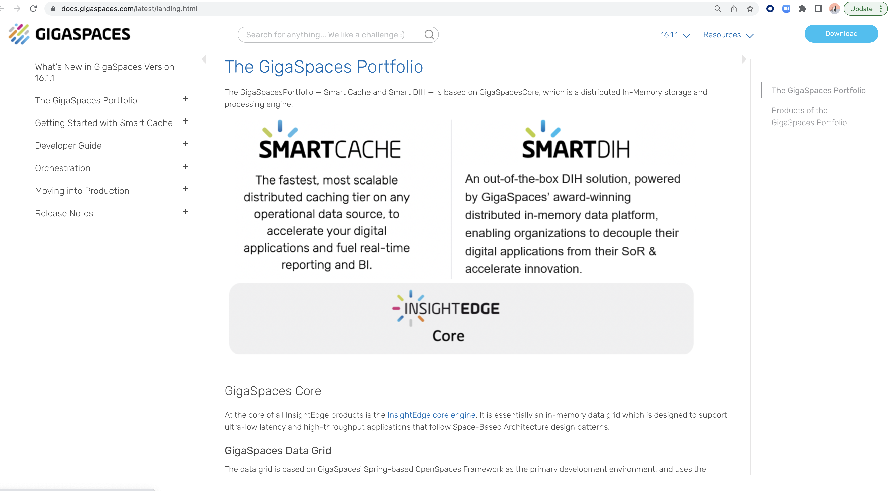
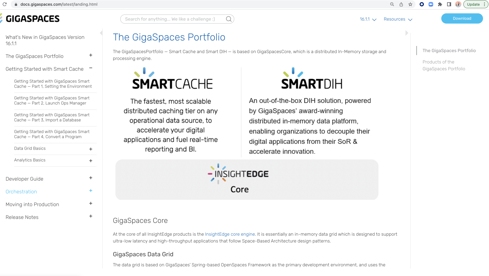

# gs-admin-training - lab01-gs_setup

## GigaSpaces setup and installation

#### 1 Setup

##### 1.1 Download and install GigaSpaces version 18.0.1:

1. Download GigaSpaces 18.0.1 from:

[Downloads](https://support2.gigaspaces.com/support/solutions/articles/60000661815-downloads)

2. Extract the zip file.

For additional information, please see our [Installation Guide](https://docs.gigaspaces.com/latest/landing-pages/installation-guide.html)


##### 1.2 Put `tryme` license in the `gs-license.txt` file located at the root of GigaSpaces installation directory.

##### 1.3 Go to `$GS_HOME/bin` open `setenv-overrides.sh` and set: <br>
   `JAVA_HOME` -> point to your java installation directory (GigaSpaces 18.0 requires Java 25) <br>
   `GS_MANAGER_SERVERS` -> set to `localhost` (`export GS_MANAGER_SERVERS="localhost"`) <br>
   `GS_LOOKUP_GROUPS` -> set to any unique identifier
   
##### 1.4 Test your GigaSpaces Installation. <br>
   You will start a GigaSpaces process (gs-agent) and you will wait to see a message that the gs-agent started successfully with groups [<your user group>]
   
    cd $GS_HOME/bin
    ./gs.sh host run-agent --manager --webui --restv3 --gsc=2
   
   This command starts a Grid Service Agent (GSA). The GSA is responsible for the components that it starts. Here it starts a Manager, the web UI, the REST Manager (REST v3, port 9090) and 2 GSCs.
   
   The following screen will appear:
   (Search for the messages below):
   
   ```
   2026-11-03 11:02:13,914 CommonClassLoader INFO [com.gigaspaces.grid.gsa] - GSA started successfully with groups [xap-18.0.1] and locators [jini://localhost:4174/]
   [manager][1/63978]    2026-11-03 11:02:16,450 CommonClassLoader INFO [com.gigaspaces.grid.gsm] - GSM started successfully [groups=[xap-18.0.1], locators=[jini://localhost:4174/], service-id=85afcb0d-0cb1-4558-ad32-3e8502866a2b]
   [manager][1/63978]    2026-11-03 11:02:17,410 GSM INFO [com.gigaspaces.grid.gsm] - Registered GSC - [GSC pid[63997] host[dixson-pc/127.0.1.1] service-id[c8af9bd0-1005-4fd8-aafb-c2c887804ca3], stats[processors=16, Heap=456.8 MB / 512 MB]], total[GSCs=1, processors=16 (peak=16)]
   [gsc][4/63997]    2026-11-03 11:02:17,444 GSC INFO [com.gigaspaces.grid.gsc] - Registered with GSM - [GSM pid[63978] host[dixson-pc/127.0.1.1]] service-id[85afcb0d-0cb1-4558-ad32-3e8502866a2b]
   [manager][1/63978]    2026-11-03 11:02:17,451 GSM INFO [com.gigaspaces.grid.gsm] - Registered GSC - [GSC pid[63985] host[dixson-pc/127.0.1.1] service-id[5d72986d-0120-457f-a1f0-243015ec9611], stats[processors=16, Heap=456.7 MB / 512 MB]], total[GSCs=2, processors=16 (peak=16)]
   [gsc][3/63985]    2026-11-03 11:02:17,481 GSC INFO [com.gigaspaces.grid.gsc] - Registered with GSM - [GSM pid[63978] host[dixson-pc/127.0.1.1]] service-id[85afcb0d-0cb1-4558-ad32-3e8502866a2b]
   ```
   
   If you see the above, you have successfully installed the courseware for our class.
   
   Examine the Manager log in `$GS_HOME/logs` (`<date>~<time>-gigaspaces-manager_1-<host>-<pid>.log`). Check that the Manager started (`GSM started successfully`) and the GSCs registered successfully (`Registered GSC`).
   
   ```
   2026-11-03 11:02:16,450 CommonClassLoader INFO [com.gigaspaces.grid.gsm] - GSM started successfully [groups=[xap-18.0.1], locators=[jini://localhost:4174/], service-id=85afcb0d-0cb1-4558-ad32-3e8502866a2b]
   2026-11-03 11:02:17,410 GSM INFO [com.gigaspaces.grid.gsm] - Registered GSC - [GSC pid[63997] host[dixson-pc/127.0.1.1] service-id[c8af9bd0-1005-4fd8-aafb-c2c887804ca3], stats[processors=16, Heap=456.8 MB / 512 MB]], total[GSCs=1, processors=16 (peak=16)]
   2026-11-03 11:02:17,451 GSM INFO [com.gigaspaces.grid.gsm] - Registered GSC - [GSC pid[63985] host[dixson-pc/127.0.1.1] service-id[5d72986d-0120-457f-a1f0-243015ec9611], stats[processors=16, Heap=456.7 MB / 512 MB]], total[GSCs=2, processors=16 (peak=16)]
   ```
   
##### 1.5	Stop processes
    Stop the gs-agent process (2 options):
    1. Ctrl+C
    2. ./gs.sh host kill-agent

#### 2	Wiki and API Doc Exercise  

##### 2.1 Validate internet connectivity by opening a browser and going to GigaSpaces site: 
        www.gigaspaces.com
##### 2.2 Click on Resources | Technical Documentation


        

     
