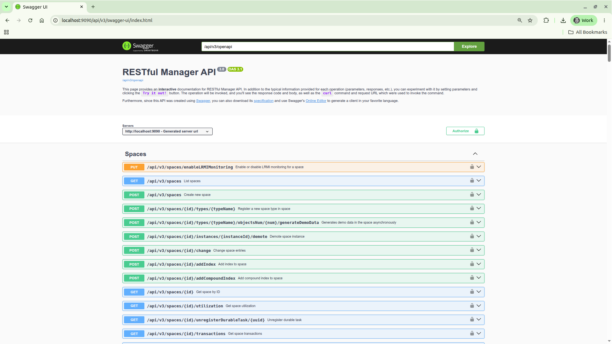
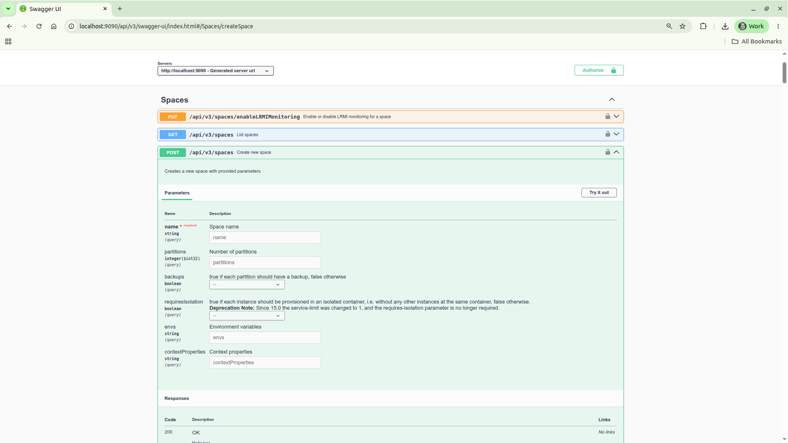
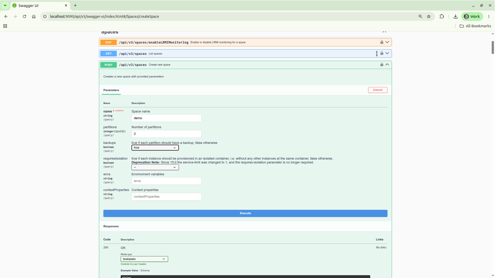
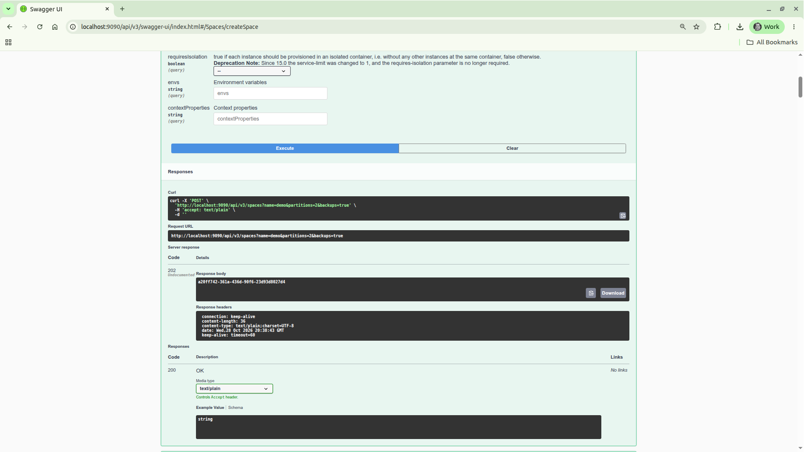
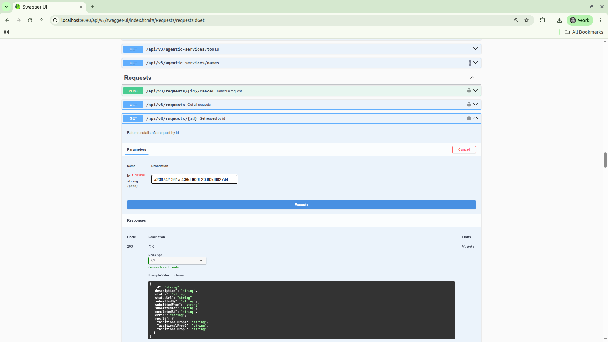
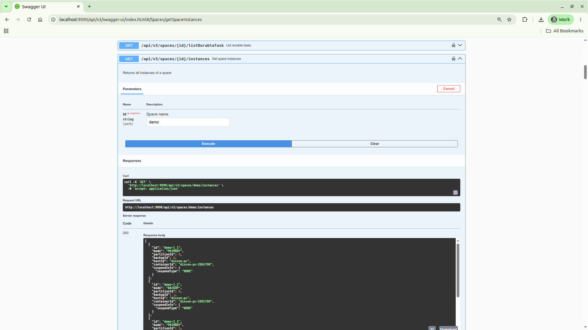
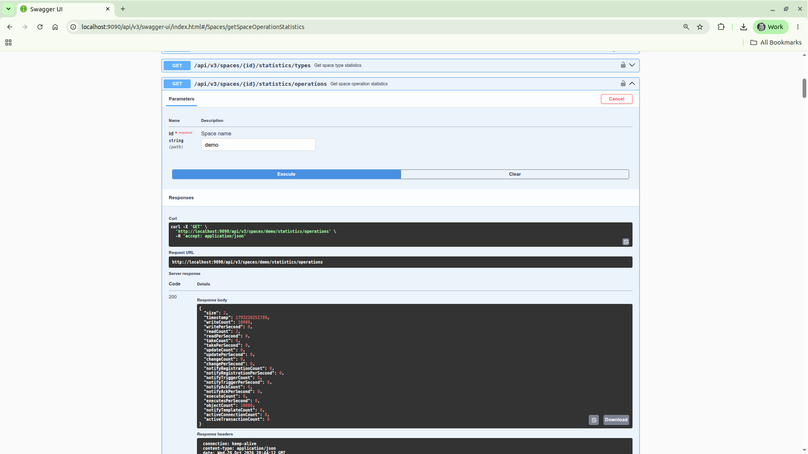
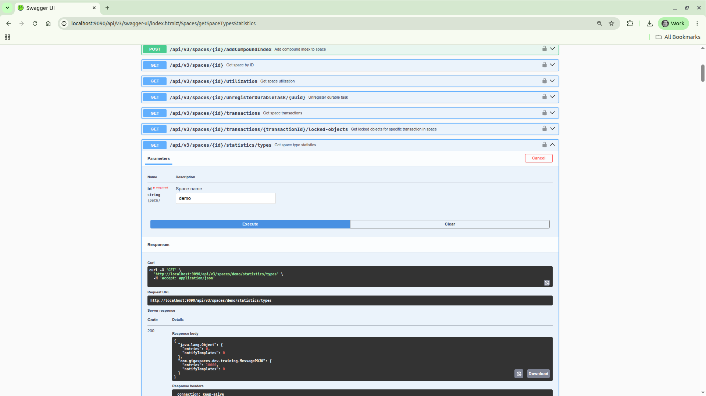

# gs-admin-training - lab03-application_components

## 	Application Level Components

###### Lab Goals 
 * Be introduced to and experience application level components.
 * Deploy, test and un-deploy applications (such as a space).
 * Experience the self-healing capability of the space.

###### Lab Description
In this lab you will start GigaSpaces service grid, deploy a Space, perform some benchmarks using a benchmark tool that will test your space, and undeploy the space. This version of the README.md will demonstrate how to use the REST Manager. You will also try to check the self-healing capabilities of the space by stopping a GSC and see how GigaSpaces heals itself.

## 1 Start the service grid

1. Go to `$GS_HOME/bin`
2. Make sure `GS_MANAGER_SERVERS` is set in `setenv-overrides.sh`:
   ```
   export GS_MANAGER_SERVERS="localhost"
   ```
3. Run: `./gs.sh host run-agent --manager --webui --restv3 --gsc=4`  
   `--restv3` starts the REST Manager (REST v3) on port 9090.

###### Checking the logs
The logs are stored in the `$GS_HOME/logs` directory. `cd` to this directory.
 * The default log file name format is `<date>~<time>-gigaspaces-<process>-<hostname>-<pid>.log`
 * The **gsa** log file contains the **GridServiceAgent** logs. This log will have messages concerning the start or restart of the GigaSpaces processes.
 * The **manager** log will contain messages from the LUS, Zookeeper and the GSM. We will go into further detail in this in a later chapter. On the service grid, this log will also have messages concerning the Processing Unit (PU)/ application deployment lifecycle.
 * The **restv3** log contains the REST Manager (REST v3) logs and the **webui** log contains the web UI logs.
 * The **gsc** log is the **GridServiceContainer** log. Applications get deployed to a gsc, so deployment issues, PU issues will appear here.
   
## 2	Deploy a space
###### Introduction to the REST Manager
1. In a browser window go to `http://localhost:9090/api/v3/swagger-ui/index.html`.

   The REST Manager is at the core of the other UIs such as the cli. The cli depends upon the REST Manager to run commands.

   The REST Manager was created using [Swagger](https://swagger.io)  
   To call an endpoint: expand it, click `Try it out`, fill in the parameters and click `Execute`.  
   Each step below also shows the equivalent `curl` command.

   

###### Deploy a space
2. We wish to deploy a space using the following configuration:

   | Field Name| Value |
   |---|---|
   | **Space Name** | demo |
   | **Number of partitions** | 2 |
   | **Backups (true or false)** | true |

   Note: This guide uses the space name `demo`, because the `writeObjects.sh` script in section 3 writes to the space `demo`.

   Expand 'Spaces' | 'POST' `/api/v3/spaces` `Create new space`.

   

   Click `Try it out` and fill in the parameters:

   |Field| Input|
   |---|---|
   |**name**|`demo`|
   |**partitions**|2|
   |**backups**|true|

   

   Click `Execute`. The response code is 202 and the Response body contains a request id.
   ```
   curl -X POST "http://localhost:9090/api/v3/spaces?name=demo&partitions=2&backups=true"
   ```
   

###### Checking the response status
3. Copy the request id. This can be used to check the status of the deployment.  
   Expand 'Requests' | 'GET' `/api/v3/requests/{id}` `Get request by id`. In the **id** field, put the request id.
   ```
   curl http://localhost:9090/api/v3/requests/<request id>
   ```
   

   You should see a response similar to the following:
   ```
   {"id":"a9974f15-1dc6-44eb-9fb4-757a227225f1","description":"Deploy space demo with 2 partitions and backups","status":"successful",
    "statusUrl":"http://localhost:9090/api/v3/spaces/demo","submittedBy":"anonymous","submittedFrom":"127.0.0.1",
    "submittedAt":"2026-10-22 20:56:45","completedAt":"2026-10-22 20:57:10",
    "result":{"demo~1_1":"SUCCESS","demo~2_1":"SUCCESS","demo~1_2":"SUCCESS","demo~2_2":"SUCCESS"}}
   ```

###### Examine the Processing Units
4. Expand 'Processing Units' | 'GET' `/api/v3/pus` `Lists processing units`. Then click `Execute`.
   ```
   curl http://localhost:9090/api/v3/pus
   ```
   It should look like the following:
   ```
   [{"name":"demo","processingUnitType":"stateful","resource":"datagrid",
     "topology":{"schema":"partitioned","partitions":2,"backupsPerPartition":1},
     "sla":{"requiresIsolation":false,"zones":[],"primaryZones":[],"maxInstancesPerVM":0,"maxInstancesPerMachine":0},
     "spaces":["demo"],"scalable":false,"status":"intact",
     "quiesceDetails":{"quiesced":false,"description":"initial","readonly":false},
     "instances":["demo~1_1","demo~1_2","demo~2_1","demo~2_2"]}]
   ```

###### Examine the Spaces
5. Expand 'Spaces' | 'GET' `/api/v3/spaces` `List spaces` to get general information on all currently deployed spaces.  
   ```
   curl http://localhost:9090/api/v3/spaces
   ```
   You should see the following:  
   ```
   [{"name":"demo","processingUnitName":"demo",
     "topology":{"schema":"partitioned","partitions":2,"backupsPerPartition":1},
     "instancesIds":["demo~1_1","demo~1_2","demo~2_1","demo~2_2"],"meta":false}]
   ```

6. To identify the primary and backup partitions for demo, expand 'Spaces' | 'GET' `/api/v3/spaces/{id}/instances` `Get space instances`.  
   Enter for id: `demo`  
   ```
   curl http://localhost:9090/api/v3/spaces/demo/instances
   ```
   

   You should see a result like the following:    
   ```
   [{"id":"demo~1_1","mode":"PRIMARY","partitionId":0,"backupId":0,"hostId":"dixson-pc","containerId":"dixson-pc~2865790","suspendInfo":{"suspendType":"NONE"}},
    {"id":"demo~1_2","mode":"BACKUP","partitionId":0,"backupId":1,"hostId":"dixson-pc","containerId":"dixson-pc~2865780","suspendInfo":{"suspendType":"NONE"}},
    {"id":"demo~2_1","mode":"PRIMARY","partitionId":1,"backupId":0,"hostId":"dixson-pc","containerId":"dixson-pc~2865824","suspendInfo":{"suspendType":"NONE"}},
    {"id":"demo~2_2","mode":"BACKUP","partitionId":1,"backupId":1,"hostId":"dixson-pc","containerId":"dixson-pc~2865883","suspendInfo":{"suspendType":"NONE"}}]
   ```

   Examine the JSON in the response. Notice each instance has an **id**, **mode**, **partitionId**, and **containerId**.  
    * The instance id has the following naming convention `<space name>~<partition number>_<1|2>`
    * In this example the PU name is the same as the space name.
    * The last digit is a 1 or 2 and it indicates whether it was started as a primary or backup partition.
    * The mode indicates whether it is a primary or backup.
    * partitionId is the partition number (starting from 0).
    * containerId is the id of the GSC that the instance was deployed to. It is in the form hostname~PID.
    
7. Which space instance is located on which GSC?


## 3	Test your space
We will now examine several operations that allow you to test, monitor and examine objects that are stored in the space.

###### Write objects to the space
1. Go to the project folder at `$GS_ADMIN_TRAINING/lab03-application_components`.
2. Run `mvn package`
3. Run the script located at `$GS_ADMIN_TRAINING/lab03-application_components/scripts/writeObjects.sh` in order to write 10,000 objects to the space.  
   Note: The script uses `$JAVA_HOME/bin/java` (or the `java` on your PATH if `JAVA_HOME` is not set). GigaSpaces 18.0 requires Java 25.

###### View operation statistics
4. To get the operation statistics expand 'Spaces' | 'GET' `/api/v3/spaces/{id}/statistics/operations` `Get space operation statistics`.  
   Enter for id: `demo`, then click `Execute`.
   ```
   curl http://localhost:9090/api/v3/spaces/demo/statistics/operations
   ```
   

   The result looks like:  
   ```
   {"size":2,"timestamp":1793220252789,"writeCount":10000,"writePerSecond":0,"readCount":2,"readPerSecond":0,"takeCount":0,"takePerSecond":0,
    "updateCount":0,"updatePerSecond":0,"changeCount":0,"changePerSecond":0,"notifyRegistrationCount":0,"notifyRegistrationPerSecond":0,
    "notifyTriggerCount":0,"notifyTriggerPerSecond":0,"notifyAckCount":0,"notifyAckPerSecond":0,"executeCount":0,"executesPerSecond":0,
    "objectCount":10000,"notifyTemplateCount":0,"activeConnectionCount":8,"activeTransactionCount":0}
   ```
   Note: The statistics are sampled. If the counts are lower than 10,000, call the endpoint again after a few seconds.

###### View data types
5. Expand 'Spaces' | 'GET' `/api/v3/spaces/{id}/statistics/types` `Get space type statistics` to get a summary of the data types in the space.  
   Enter for id: `demo`. Click `Execute`.    
   ```
   curl http://localhost:9090/api/v3/spaces/demo/statistics/types
   ```
   

   The result looks like:  
   ```
   {"java.lang.Object":{"entries":0,"notifyTemplates":0},"com.gigaspaces.dev.training.MessagePOJO":{"entries":10000,"notifyTemplates":0}}
   ```

6. For more detail on each type (its properties, id, routing and indexes), expand 'Spaces' | 'GET' `/api/v3/spaces/{id}/objectsTypeInfo` `Get objects type info`.  
   Enter for id: `demo`. Click `Execute`.    
   ```
   curl http://localhost:9090/api/v3/spaces/demo/objectsTypeInfo
   ```
   The result looks like:  
   ```
   {"tiered":false,"tieredConfiguration":null,"objectTypesMetadata":[{"objectName":"com.gigaspaces.dev.training.MessagePOJO","entries":10000,
    "notifyTemplates":0,"isSupportFifo":false,"spaceId":"counter","routing":"counter","broadcast":false,
    "indexes":[{"name":"counter","indexType":"regular","method":"EQUAL","hits":null}],
    "schema":[{"name":"content","typeName":"byte[]","storageType":"OBJECT","isSpaceId":false,"isRouting":false,"isIndex":false},
              {"name":"counter","typeName":"long","storageType":"OBJECT","isSpaceId":true,"isRouting":true,"isIndex":true}]}]}
   ```

###### Query the "MessagePOJO" type
7. Expand 'Spaces' | 'GET' `/api/v3/spaces/{id}/query` `Query space`.  
   Enter for id: `demo`, typeName: `com.gigaspaces.dev.training.MessagePOJO`. Click `Execute`.    
   ```
   curl "http://localhost:9090/api/v3/spaces/demo/query?typeName=com.gigaspaces.dev.training.MessagePOJO&maxResults=3"
   ```
   You get the following (10 results by default, here limited with `maxResults=3`):  
   ```
   {"columns":["content","counter"],"results":[{"values":["[B@3f773a2b","9883"]},{"values":["[B@286ded3d","9721"]},{"values":["[B@4993afd1","9613"]}],"hasMore":false}
   ```
   Note: the type name should be fully qualified class name with the package name.

## 4 Self-Healing

In this exercise you will be introduced to the self-healing capabilities of a space.
Basically we will ‘kill’ (using Windows Task Manager or kill -9) a GSC process and see that it restarts automatically by the gs-agent and that new partition are created accordingly.

1. Previously, after we deployed the space, we ran `/api/v3/spaces/{id}/instances` `Get space instances` and we could see the containerIds and therefore the PIDs associated with the GSCs. Choose 1 of the GSC's PID (with primary space instance on it) and use the Task Manager or (kill -9 for Linux) in order to kill the process.

2. Once again, run `/api/v3/spaces/{id}/instances` `Get space instances` in order to check the recovery status.  
   Note: The killed instance may still be listed for up to a minute, until the Manager detects that the GSC is gone.

3. The following is a summary of the self-healing process.

 * A backup was promoted to Primary.
 * GSC was re-launched by the gs-agent.
 * A new backup partition was provisioned.
 * Recovery is performed, the backup partition is now a primary.

5. Restart a primary partition by selecting the primary partition. What happens?  
   When using the REST API these endpoints can be used:  
    * 'Spaces' | 'GET' `/api/v3/spaces/{id}/instances` `Get space instances`, then
    * 'Containers' | 'POST' `/api/v3/containers/{id}/restart` `Restart a container` (id is the containerId, for example `dixson-pc~2865790`)
   ```
   curl -X POST http://localhost:9090/api/v3/containers/<container id>/restart
   ```

6. In general, if you need to change a primary space to a backup it is better to use the demote command:  
    * 'Spaces' | 'GET' `/api/v3/spaces/{id}/instances` `Get space instances`, then
    * 'Spaces' | 'POST' `/api/v3/spaces/{id}/instances/{instanceId}/demote` `Demote space instance`
   ```
   curl -X POST http://localhost:9090/api/v3/spaces/demo/instances/<instance id>/demote
   ```
   Note: The restart and demote calls run asynchronously. They return a request id right away, and the instance mode changes only after the request completes (a demote can take about 10 seconds). Check the request with 'Requests' | 'GET' `/api/v3/requests/{id}` (see step 3 in section 2) and wait for `"status":"successful"` before checking `/api/v3/spaces/{id}/instances` again.

## 5 Un-deploy a space 
To undeploy a space the following can be run:    
'Processing Units' | 'DELETE' `/api/v3/pus/{id}` `Undeploys a processing unit` (id: `demo`)
```
curl -X DELETE http://localhost:9090/api/v3/pus/demo
```

---
## Additional resources
 * [Instructions for cli](./README.md)
 * [Instructions for SpaceDeck](./spacedeck-README.md)


