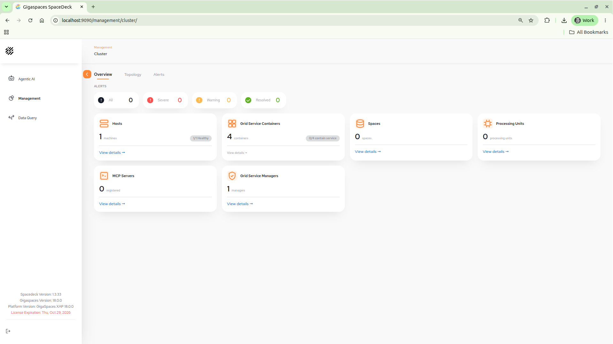
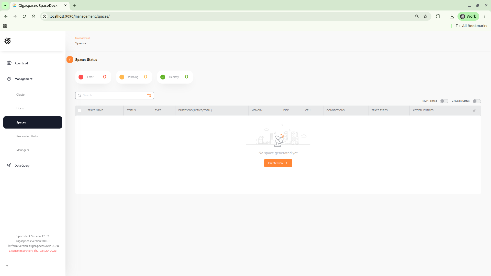
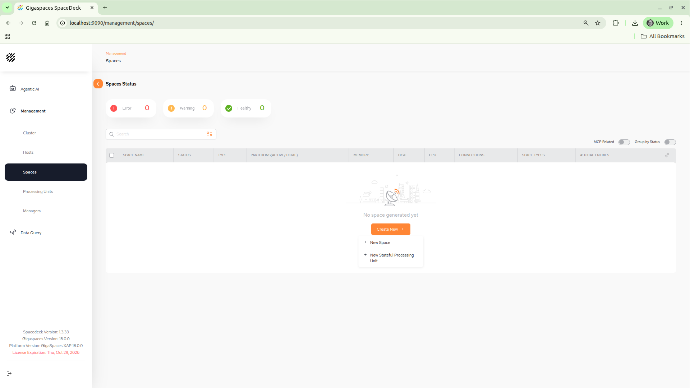
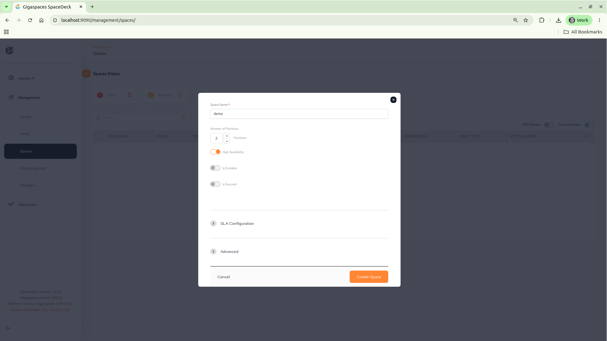
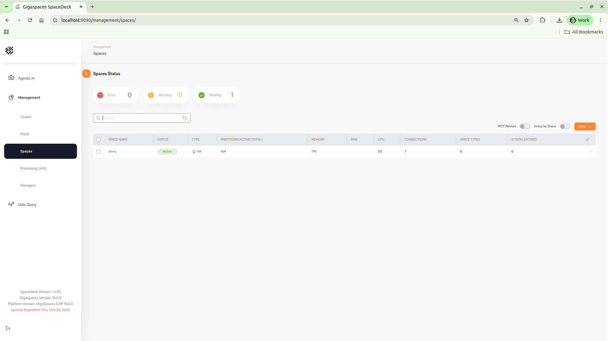
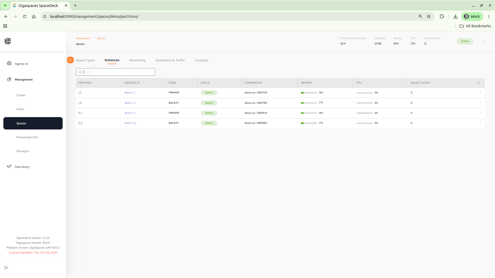
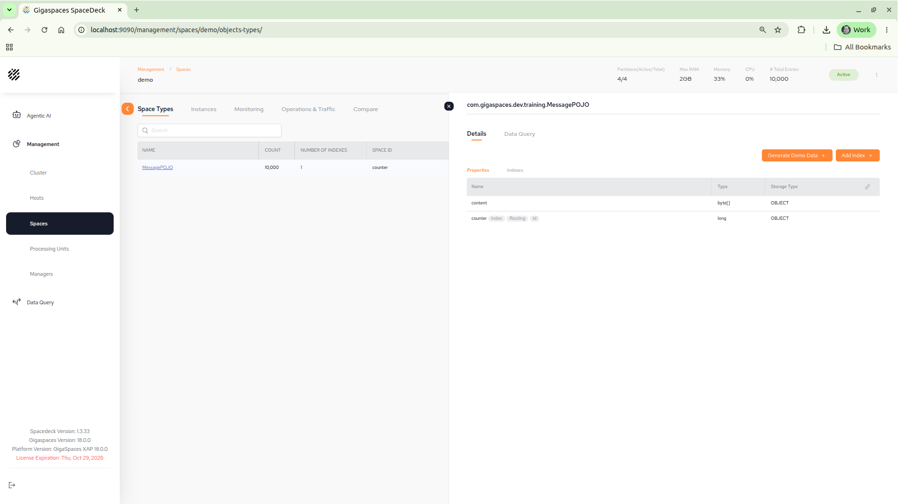
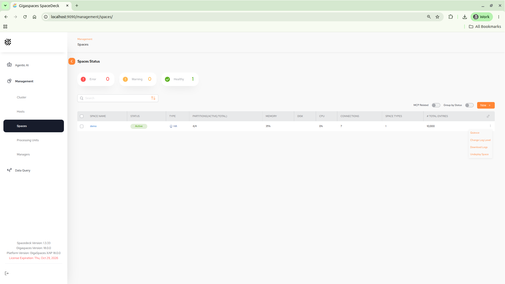

# gs-admin-training - lab03-application_components

## 	Application Level Components

###### Lab Goals 
 * Be introduced to and experience application level components.
 * Deploy, test and un-deploy applications (such as a space).
 * Experience the self-healing capability of the space.

###### Lab Description
In this lab you will start GigaSpaces service grid, deploy a Space, write objects to the space, examine it, and undeploy the space. You will perform most actions using SpaceDeck, the GigaSpaces web UI. You will also try to check the self-healing capabilities of the space by stopping a GSC and see how GigaSpaces heals itself.

## 1 Start the service grid

1. Go to `$GS_HOME/bin`
2. Make sure `GS_MANAGER_SERVERS` is set in `setenv-overrides.sh`:
   ```
   export GS_MANAGER_SERVERS="localhost"
   ```
3. Run: `./gs.sh host run-agent --manager --webui --restv3 --gsc=4`  
   `--restv3` starts the REST Manager (REST v3) on port 9090. SpaceDeck is served on the same port.
4. In a browser window go to `http://localhost:9090/management/cluster/`.
5. The 'Management' | 'Cluster' 'Overview' tab shows a summary of the grid: alerts, Hosts, Grid Service Containers, Spaces, Processing Units, MCP Servers and Grid Service Managers. You should see 1 host, 4 containers and 1 manager. The SpaceDeck and GigaSpaces versions are shown at the bottom left.

   

## 2	Deploy a space
1. In the left menu, choose 'Management' | 'Spaces'. No spaces are deployed yet.

   

2. Click 'Create New' and choose 'New Space'.

   

3. Fill in the fields as follows.

| Field Name| Value |
|---|---|
| **Space Name** | demo |
| **Number of Partitions**| 2 |
| **High Availability** | on (1 backup per partition) |
| **Is Scalable** | off |
| **Is Secured** | off |

   Note: This guide uses the space name `demo`, because the `writeObjects.sh` script in section 3 writes to the space `demo`.

   

4. Press the 'Create Space' button. After the deployment is done, the space is listed with status 'Active', type 'HA' and 4/4 partitions (active/total):

   

5. Click on the space name `demo` and select the 'Instances' tab.

   * Identify the primary and backup partitions in the MODE column.
   * The **INSTANCE ID** has the following naming convention `<space name>~<partition number>_<1|2>`
   * The **CONTAINER ID** is a String that contains hostname~PID.

     

6. Examine which space instance is located on which GSC?

## 3	Test your space
We will now examine several operations that allow you to test, monitor and examine objects that are stored in the space.

###### Write objects to the space
1. Go to the project folder at `$GS_ADMIN_TRAINING/lab03-application_components`.
2. Run `mvn package`
3. Run the script located at `$GS_ADMIN_TRAINING/lab03-application_components/scripts/writeObjects.sh` in order to write 10,000 objects to the space.  
   Note: The script uses `$JAVA_HOME/bin/java` (or the `java` on your PATH if `JAVA_HOME` is not set). GigaSpaces 18.0 requires Java 25.

###### View data types
4. In the space `demo`, select the 'Space Types' tab. The `MessagePOJO` type is listed with a count of 10,000.
5. Click on `MessagePOJO`. The 'Details' panel shows the 'Properties' of the type. Notice that `counter` is the index, routing and id property.

   

6. Select the 'Data Query' tab in the 'Details' panel to examine the objects written to space.

###### View statistics
7. Examine the 'Monitoring' and 'Operations & Traffic' tabs of the space.

## 4	Self-Healing

In this exercise you will be introduced to the self-healing capabilities of a space.
Basically we will ‘kill’ (using Windows Task Manager or kill -9) a GSC process and see that it restarts automatically by the gs-agent and that new partition are created accordingly.

1. The PID of each GSC is the last part of the CONTAINER ID in the space 'Instances' tab. Choose 1 of the GSCs PID (with primary space instance on it) and use the Task Manager or (kill -9 for Linux) in order to kill the process.

2. Monitor the view in the 'Instances' tab in order to check the recovery status.  
   Note: The killed instance may still be listed for up to a minute, until the Manager detects that the GSC is gone.

3. The following is a summary of the self-healing process.

   * A backup was promoted to Primary.
   * GSC was re-launched by the gs-agent.
   * A new backup partition was provisioned.
   
4. Recovery is performed, the backup partition is now a primary.

5. Restart a primary partition. What happens?  
   When using the cli these commands can be used:  
   `./gs.sh container list` followed by `./gs.sh container restart <container ID>`
 
## 5	Un-deploy a space 

1. In 'Management' | 'Spaces', click the menu (⋮) at the end of the `demo` row and choose 'Undeploy Space'.

   

## Additional resources
 * [Instructions for cli](./README.md)
 * [Instructions for REST API](./restapiv3-README.md)
