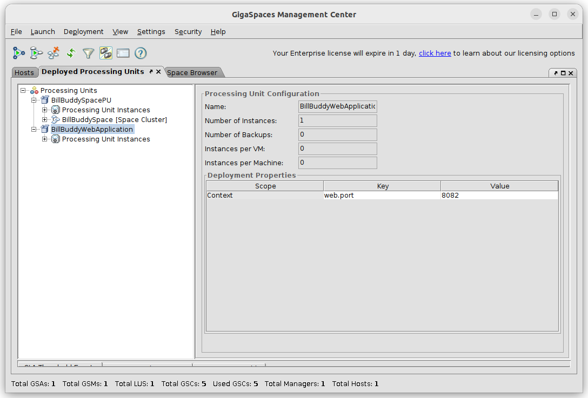
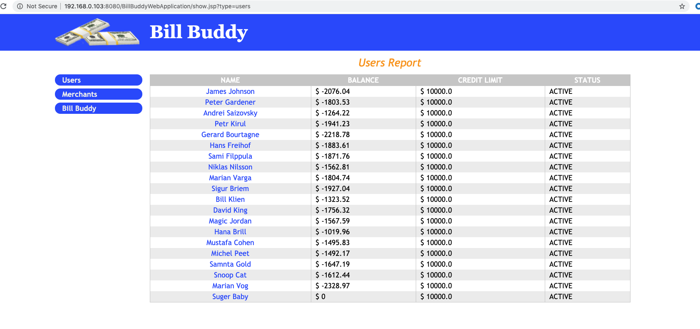

# gs-admin-training - lab04-BillBuddy_training_example

# The Bill Buddy Application

## Lab Goals

1. Experience an application deployment process.
2. Get familiar with the BillBuddy application.

## Lab Description
In this lab we will focus on deployment and the application and not be concerned with code, therefore simply focus on the deployment process, you will use a similar process throughout the labs.

#### 1	Start gs-agent

1. Navigate to `$GS_HOME/bin`

2. Set the Manager server in `setenv-overrides.sh`.  
   Edit `$GS_HOME/bin/setenv-overrides.sh` and uncomment/set `GS_MANAGER_SERVERS`:
    ```
    export GS_MANAGER_SERVERS="localhost"
    ```
   Note: For a multi-host grid, use the host name(s) of the Manager server(s) instead of `localhost`.
        
3. Start the Service Grid with a local Manager server, the REST Manager (REST v3, port 9090), the web UI and 5 GSCs:
    ```
    ./gs.sh host run-agent --manager --webui --restv3 --gsc=5
    ```
    
#### 2	Deploy BillBuddy_Space
    
1. Open `$GS_TRAINING_HOME/lab04-BillBuddy_training_example` project with Intellij (open pom.xml).  
   Note: GigaSpaces 18.0 requires Java 25. Set the IntelliJ project SDK (and `JAVA_HOME` for Maven) to a JDK 25.
2. Run `mvn package`

```
    ~/gs-admin-training/lab04-BillBuddy_training_example$ mvn package
    
    
    [INFO] Reactor Summary:
    [INFO] 
    [INFO] Lab4 ............................................... SUCCESS [  0.204 s]
    [INFO] BillBuddyModel ..................................... SUCCESS [  1.087 s]
    [INFO] BillBuddy_Space .................................... SUCCESS [  0.207 s]
    [INFO] BillBuddyAccountFeeder ............................. SUCCESS [  0.189 s]
    [INFO] BillBuddyCurrentProfitDistributedExecutor .......... SUCCESS [  0.225 s]
    [INFO] BillBuddyWebApplication ............................ SUCCESS [  0.349 s]
    [INFO] BillBuddyPaymentFeeder ............................. SUCCESS [  0.190 s]
    [INFO] ------------------------------------------------------------------------
    [INFO] BUILD SUCCESS
```


###### Add GS_LOOKUP_GROUPS & GS_LOOKUP_LOCATORS
3. Set IntelliJ path variables (under File | Settings | Appearance & Behavior | Path Variables)

For example set `GS_LOOKUP_LOCATORS=localhost` and `GS_LOOKUP_GROUPS=xap-18.0.1`

4. Copy the runConfigurations directory to the Intellij .idea directory to enable the Java Application configurations. Restart Intellij.

5. Open a new terminal and navigate to `$GS_HOME/bin`
    ```
    cd $GS_HOME/bin
    ```
6. Use GS CLI to deploy BillBuddy_Space:
    ``` 
    ./gs.sh pu deploy BillBuddySpacePU ~/gs-admin-training/lab04-BillBuddy_training_example/BillBuddy_Space/target/BillBuddy_Space.jar 
    ```
#### 3	Run BillBuddyAccountFeeder from Intellij

1. From the Intellij run configuration select BillBuddyAccountFeeder and run it.

###### This application writes Users, Merchants and Contracts to the Space
 
2. Validate Users and Merchants were written to the space. Please refer to 'lab03-application_components' for instructions on how to verify data types. 

3. Query the list of Users by executing the following SQL:  
   Please refer to 'lab03-application_components' for instructions on how to query a space.
    ```
        SELECT * FROM com.gs.billbuddy.model.User WHERE rownum<5000
    ```    
###### Note: Fully qualified class name is required.

#### 4	Run BillBuddyPaymentFeeder project
The BillBuddyPaymentFeeder application creates payments by randomly choosing a user, a merchant and an amount and performs the initial process of a payment.  
This includes deposit and withdrawal updates of each party’s balance appropriately.  
After the payment is initially processed it is written to the space for further processing.  
A new Payment is created every second.
 
1. Run the BillBuddyPaymentFeeder using Intellij:  
   Use the same instructions as used for the BillBuddyAccountFeeder.

2. Validate Payments were written to the space.  
   Click the Payment Data Type Name as you did in section 3.3
 
3. Go to the statistics operations and see that a payment is actually added every second.  
   Please review 'lab03-application_components' for information on operations statistics.
4. Go to the Data Types view. Which objects counts are increasing?

#### 5 Deploy BillBuddyWebApplication project

1. Open a new Terminal and navigate to `$GS_HOME/bin`

2. Use the GS CLI to deploy BillBuddyWebApplication:
``` 
./gs.sh pu deploy --property=web.port=8082 BillBuddyWebApplication ~/gs-admin-training/lab04-BillBuddy_training_example/BillBuddyWebApplication/target/BillBuddyWebApplication.war
```
3. Validate the application is deployed. In the same terminal, list the processing units:
   ```
   ./gs.sh pu list
   ```
   BillBuddyWebApplication should be listed (type WEB, status INTACT) next to BillBuddySpacePU:
   ```
   NAME                       TYPE        SPACE             TOPOLOGY           STATUS    RESOURCE                       QUIESCED    INSTANCES COUNT
   BillBuddySpacePU           STATEFUL    BillBuddySpace    partitioned 2,1    INTACT    BillBuddy_Space.jar            false       4
   BillBuddyWebApplication    WEB                           -                  INTACT    BillBuddyWebApplication.war    false       1
   ```
   Then list its instances to see which host the web application is running on (HOST ID):
   ```
   ./gs.sh pu list-instances BillBuddyWebApplication
   ```
   ```
   INSTANCE ID                  HOST ID      CONTAINER ID
   BillBuddyWebApplication~1    dixson-pc    dixson-pc~2870353
   ```
   Note: the CLI (and the REST Manager) do not show the web port. To confirm it, check the log of the container that runs the web application.  
   The number after `~` in the CONTAINER ID is the container's process id, and it is part of the container's log file name (`<date>~<time>-gigaspaces-gsc_<n>-<host>-<pid>.log`):
   ```
   cd $GS_HOME/logs
   grep "Deployed web application" *gsc*-2870353.log
   ```
   The line shows the address, port and context path of the web application:
   ```
   ... Deployed web application [127.0.1.1:8082/BillBuddyWebApplication]
   ```

   *Legacy: with gs-ui (`$GS_HOME/bin/gs-ui.sh`, a separate download since version 17.0), go to the 'Deployed Processing Units' tab, click on the BillBuddyWebApplication PU and click on Config. The `web.port` deployment property is shown:*

   

4. Build the url from the host, the `web.port` property used in the deploy command (8082) and the context path (the war name, `BillBuddyWebApplication`):  
   `http://<host>:8082/BillBuddyWebApplication/`  
   Open it in a browser to reach the BillBuddy web application: 

    

5. Congratulations, you have deployed the BillBuddy web application!  
   Navigate through the application pages and investigate it.

---
## Additional Resources
[Deployment using other UIs](./deploy.md)
