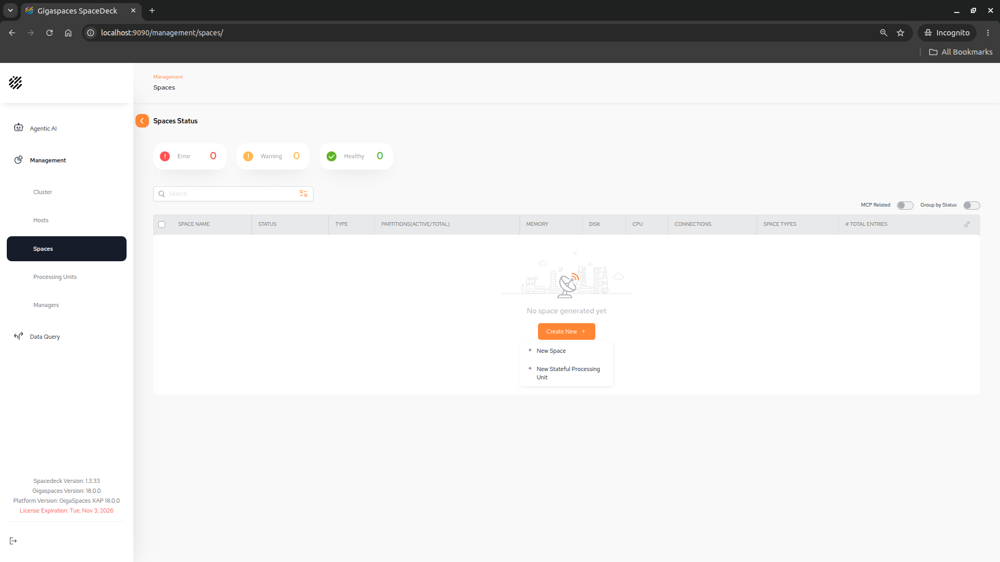
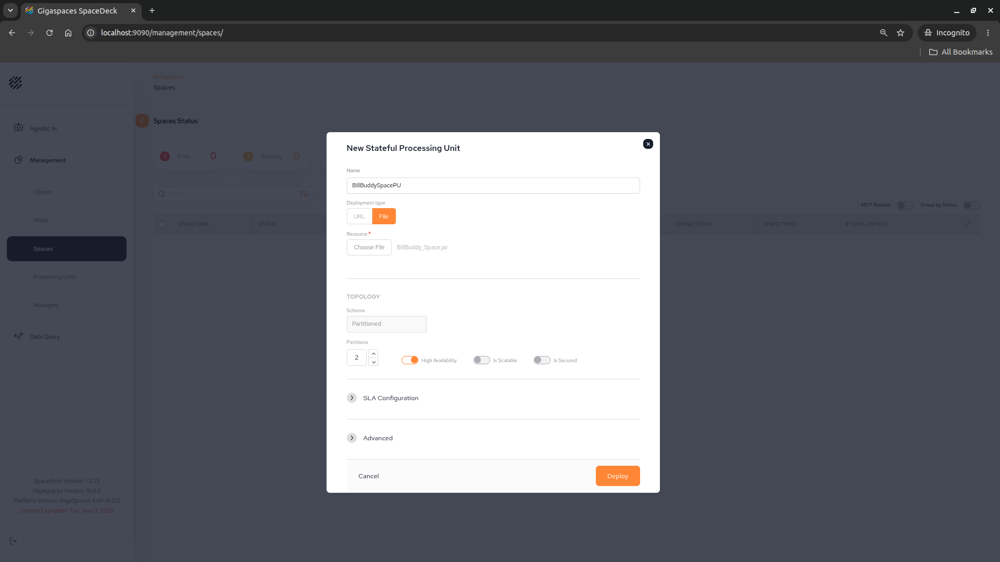
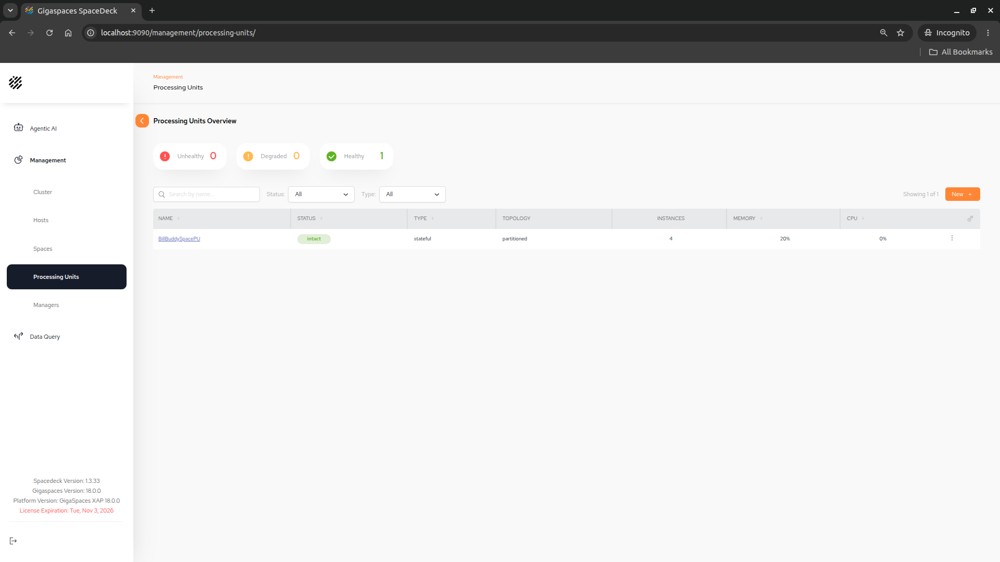
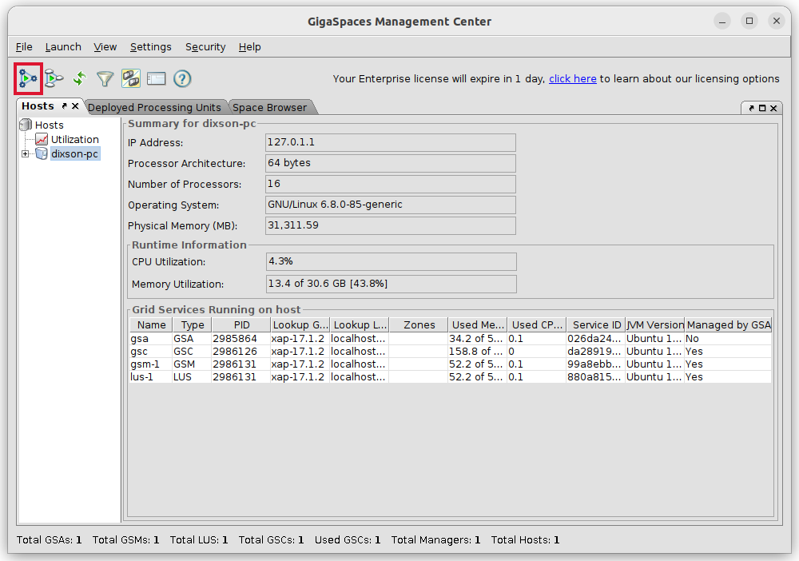
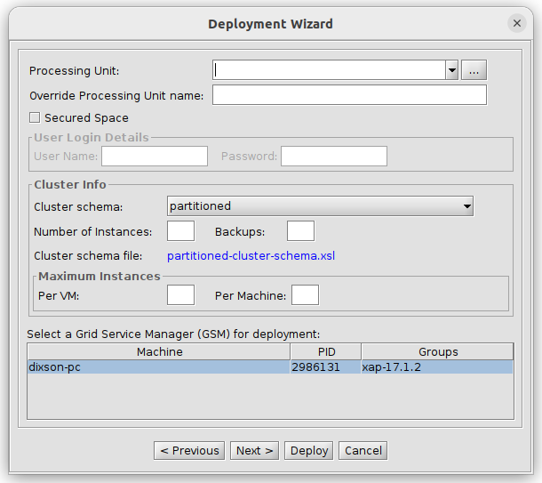

# Deployment using other UIs

## REST API
Using the REST Manager (REST v3), deployment is a two-step process that requires the artifact to be uploaded first.  
The REST Manager is started by the `--restv3` option of `gs.sh host run-agent` (for example `./gs.sh host run-agent --manager --webui --restv3 --gsc=5`) and listens on port 9090.

1. In a browser window, open `localhost:9090/api/v3/swagger-ui/index.html`.
2. Expand the section 'Processing Units' | 'PUT' `/api/v3/pus/resources` `Upload resource for processing unit`.
3. Click `Try it out`, use the file picker to upload your PU jar (`BillBuddy_Space.jar`), then click `Execute`.  
   A successful upload returns code 201 and the resource URL.
4. To validate it has been successful, you can run 'Processing Units' | 'GET' `/api/v3/pus/resources` `Get resources for processing units`.
5. Expand the section 'Processing Units' | 'POST' `/api/v3/pus` `Deploys a new processing unit` and click `Try it out`.
6. The 'Request body' is pre-filled with a JSON template:
   ```
   {
     "name": "string",
     "resource": "string",
     "topology": {
       "schema": "string",
       "instances": 0,
       "partitions": 0,
       "backupsPerPartition": 0
     },
     "sla": {
       "requiresIsolation": true,
       "zones": [
         "string"
       ],
       "primaryZones": [
         "string"
       ],
       "maxInstancesPerVM": 0,
       "maxInstancesPerMachine": 0
     },
     "contextProperties": {}
   }
   ```
7. Modify the JSON so it becomes:
   ```
   {
     "resource": "BillBuddy_Space.jar",
     "topology": {
       "schema": "partitioned",
       "partitions": 2,
       "backupsPerPartition": 1
     },
     "name": "BillBuddySpacePU"
   } 
   ```
    * `resource` - pu resource name.
    * `schema` - partitioned for processing units that have a space defined in it.
    * `partitions` - number of partitions.
    * Since this is a partitioned space, remove `instances` from the topology.
    * `backupsPerPartition` - 0|1. 0 means no backups, 1 means 1 backup per each partition.
    * `name` - the name of the processing unit.
    * For this example we have removed `sla` and `contextProperties`.  
   
   Lastly, click `Execute`. The response (code 202) contains a request id.
8. The request id can be used to request a status of the deployment under 'Requests' | 'GET' `/api/v3/requests/{id}` `Get request by id`.  
   Or you can get the PUs via 'Processing Units' | 'GET' `/api/v3/pus` `Lists processing units`.

The same steps using curl:
```
curl -X PUT -F "file=@BillBuddy_Space/target/BillBuddy_Space.jar" http://localhost:9090/api/v3/pus/resources
curl -X POST -H "Content-Type: application/json" -d '{"resource":"BillBuddy_Space.jar","topology":{"schema":"partitioned","partitions":2,"backupsPerPartition":1},"name":"BillBuddySpacePU"}' http://localhost:9090/api/v3/pus
curl http://localhost:9090/api/v3/requests/<request id>
```


## SpaceDeck
SpaceDeck is the GigaSpaces web UI. It is served by the REST Manager on port 9090.

1. In a browser window, open `http://localhost:9090` and choose 'Management' | 'Spaces' in the left menu.
2. Click 'Create New' and choose 'New Stateful Processing Unit'.

   

3. Fill in the fields as follows.

   | Field Name | Value |
   |---|---|
   | **Name** | BillBuddySpacePU |
   | **Deployment type** | File |
   | **Resource** | Click 'Choose File' and select `BillBuddy_Space/target/BillBuddy_Space.jar` |
   | **Schema** | Partitioned |
   | **Partitions** | 2 |
   | **High Availability** | on (1 backup per partition) |
   | **Is Scalable** | off |
   | **Is Secured** | off |

   

4. Click 'Deploy'.

5. To validate the deployment, choose 'Management' | 'Processing Units' in the left menu. BillBuddySpacePU should be listed with status 'intact', type 'stateful', topology 'partitioned' and 4 instances (2 partitions, each with 1 backup):

   

## gsui (legacy)
*Legacy: gs-ui is the older desktop UI. Use the CLI or the REST Manager instead.*

1. Go to `$GS_HOME/bin` and run `gs-ui.sh`  
   Note: gs-ui requires a separate download.
2. Click on the 'Deploy application' button. Alternatively go to the 'File' menu 'Launch' | `SBA Application - Processing Unit...`.
   
3. You should see the 'Deployment wizard'  
   
4. Use the file picker to upload the BillBuddy_Space jar file. The other fields should have the following values.

   |Field|Value|
   |---|---|
   |Cluster schema|partitioned|
   |Number of instances|2|
   |Backups|1|
   |Max Instances Per VM|Gets filled in with 1 automatically|

5. Refer to 'lab03-application_components' for further information on checking the processing unit.
