# gs-admin-training - lab05-spacedeck

# GigaSpaces SpaceDeck

## Lab Goals

1. Explore from close GS SpaceDeck windows.
2. Get familiar with GS SpaceDeck capabilities.

## Lab Description
In this lab we will focus on GigaSpaces SpaceDeck functionalities.  
To better know its capabilities you will use the ui demo tool in the `ui-demo` folder of this lab for your convenience.  
SpaceDeck is available at http://localhost:9090/

### 1 Build and run the ui demo tool:

 * Open [ui-demo/README.MD](./ui-demo/README.MD) and follow its instructions.
 * Once done with the above README, continue with the next section **(2 UI DEMO)** 
       
### 2 UI DEMO

Open the ui demo:
 * http://localhost:8280/

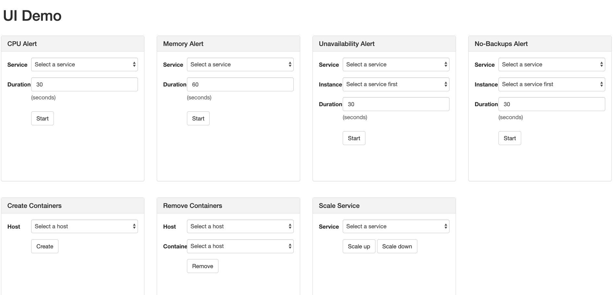

#### 2.1 CPU Alert:
 * Choose ProductsCatalog Service and trigger the CPU Alert:
  
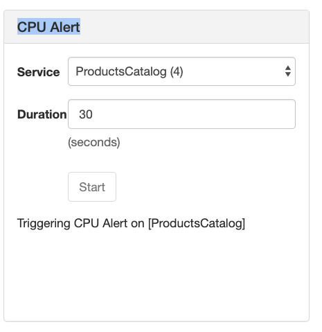
 * Troubleshoot it in SpaceDeck ('Management' | 'Spaces', click the space `space`, 'Instances' tab):
  
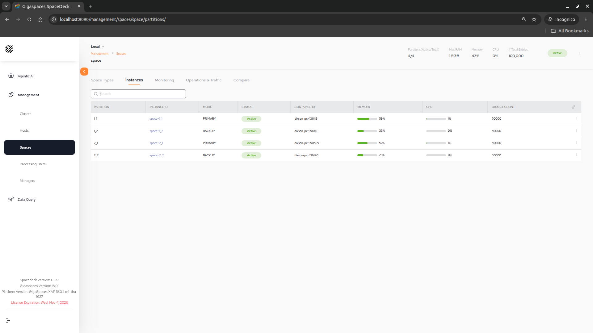

 * Note: The CPU Alert keeps one thread busy in the container that hosts the first ProductsCatalog partition's primary instance. Watch that container's CPU usage go up in SpaceDeck for the selected duration. It does not usually raise the built-in CPU Utilization alert: that alert is measured on the whole host, and by default fires only when the host's CPU averages over 80% for 60 seconds (`$GS_HOME/config/alerts/alerts.xml`, `CpuUtilizationAlertConfiguration`: `high-threshold-perc`, `measurement-period-milliseconds`). To raise it, the task could run one busy thread per core with a duration of more than 60 seconds, or the thresholds in `alerts.xml` could be lowered.

#### 2.2 Memory Alert:
 * Choose ProductsCatalog Service and trigger the Memory Alert:
  
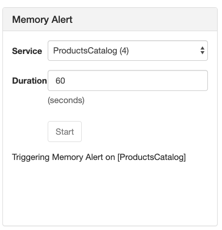
 * Troubleshoot it in SpaceDeck ('Management' | 'Processing Units'):

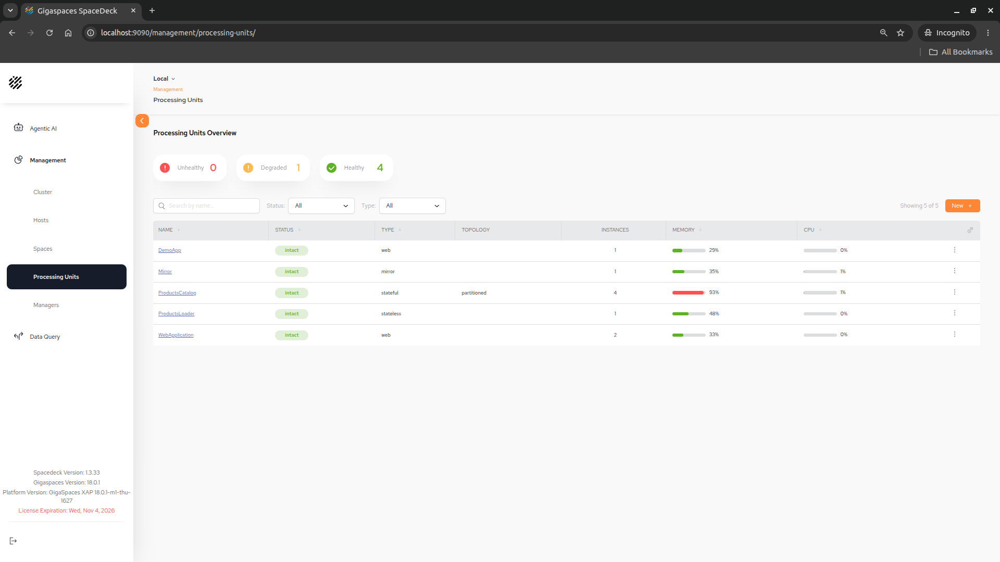

#### 2.3 Unavailability Alert:
 * Choose Mirror Service and trigger the Unavailability Alert:
  
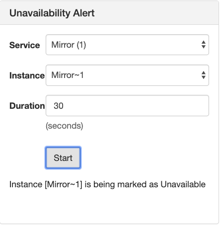
 * Troubleshoot it in SpaceDeck ('Management' | 'Processing Units'):
  
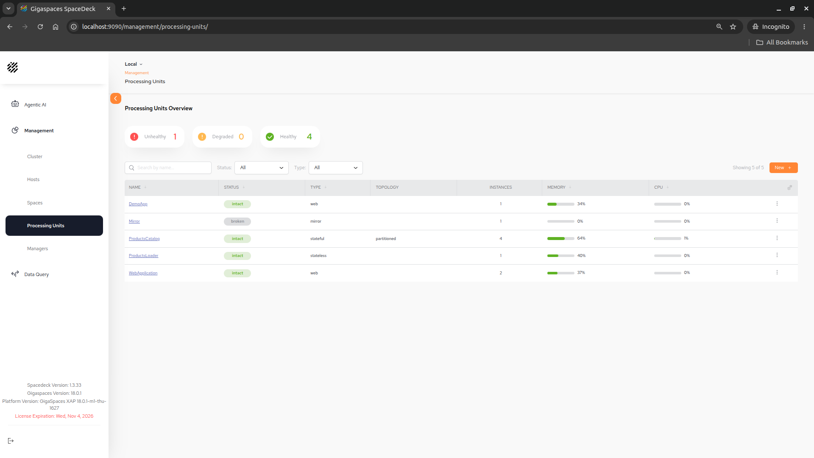

#### 2.4 No-Backups Alert:
 * Choose ProductsCatalog Service and trigger the No-Backups Alert:
  
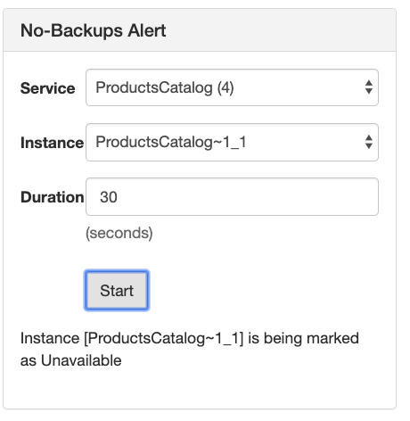
 * Troubleshoot it in SpaceDeck ('Management' | 'Spaces', click the space `space`, 'Instances' tab):

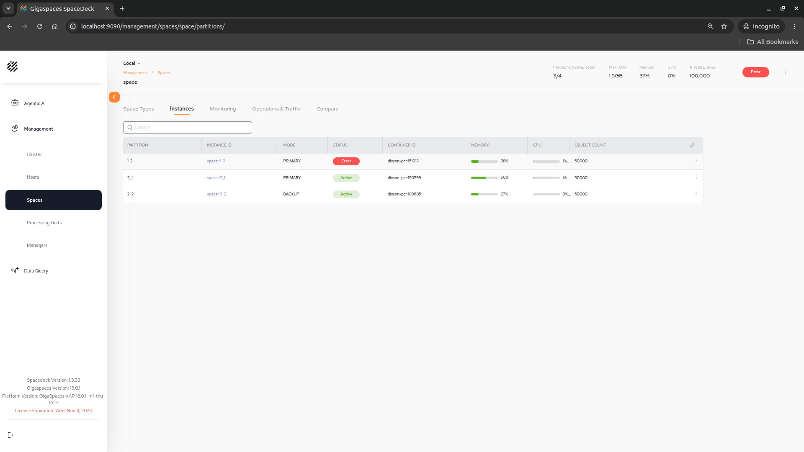

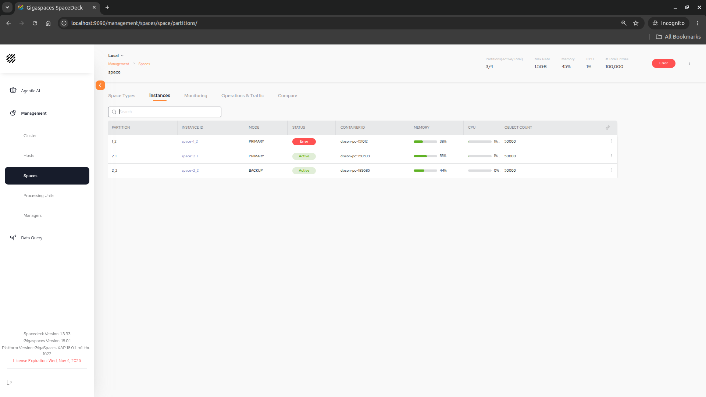

#### 2.5 Create Containers:
 * Select your host and click the 'Create' button:
  
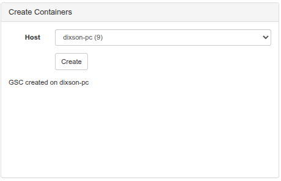
 * Verify that you have a free GSC in SpaceDeck ('Management' | 'Cluster', 'Topology' tab, 'Idle container'):
  
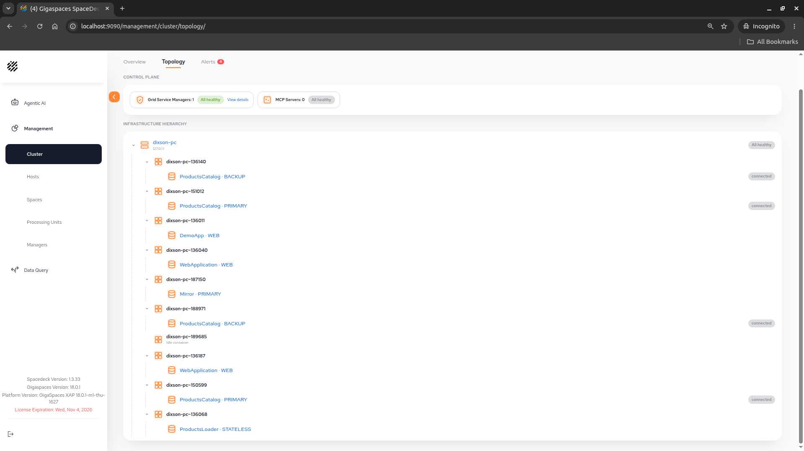

#### 2.6 Scale Up Service:
 * Choose WebApplication Service and click the Scale up button:
  
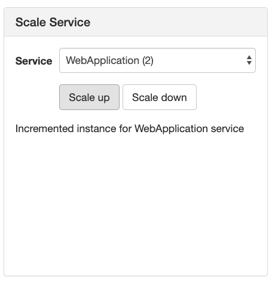
 * Verify WebApplication instance was incremented in SpaceDeck ('Management' | 'Processing Units', click WebApplication):
  
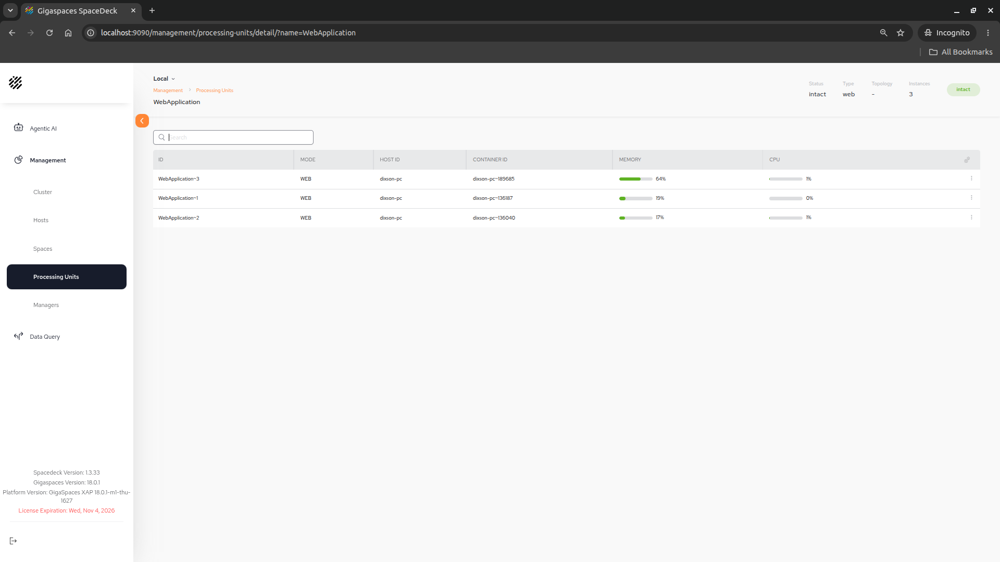

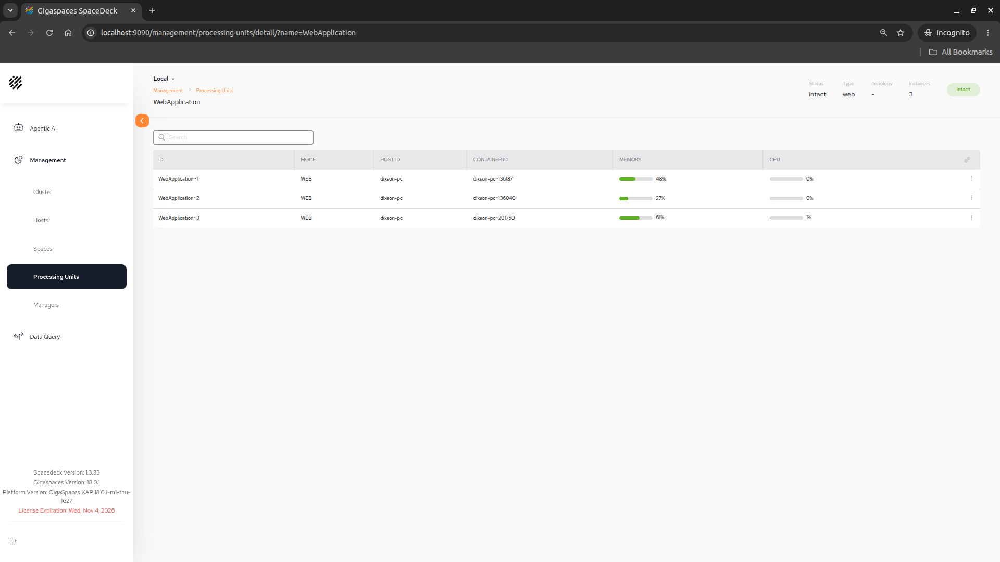

#### 2.7 Scale Down Service:
 * Choose WebApplication Service and click the Scale down button:

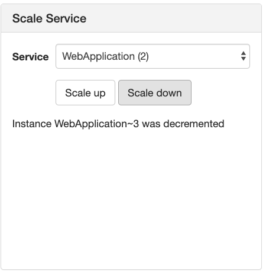
 * Verify WebApplication instance was decremented in SpaceDeck ('Management' | 'Processing Units', click WebApplication):

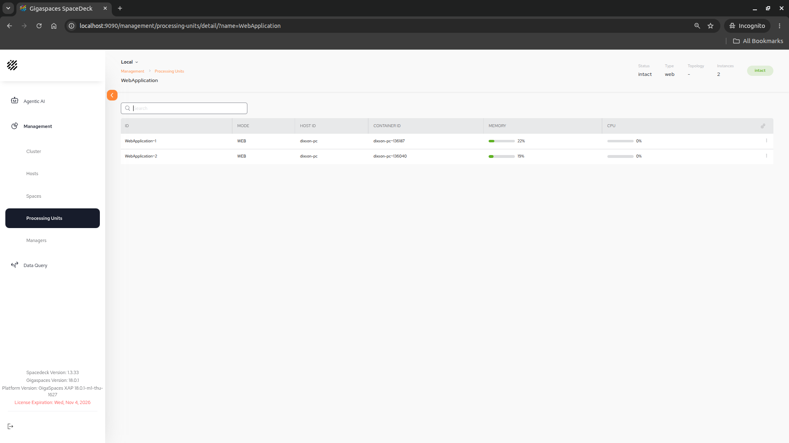

#### 2.8 Remove Containers:
 * Open SpaceDeck and verify which GSC pid is empty with no service deployed on it ('Management' | 'Cluster', 'Topology' tab, 'Idle container'):

 * Select your host and Container to remove click the Remove button:

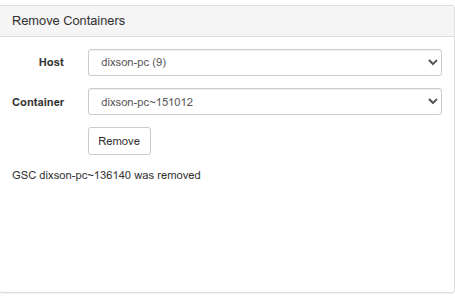
 * Verify in SpaceDeck that the spare GSC was removed ('Management' | 'Cluster', 'Topology' tab):
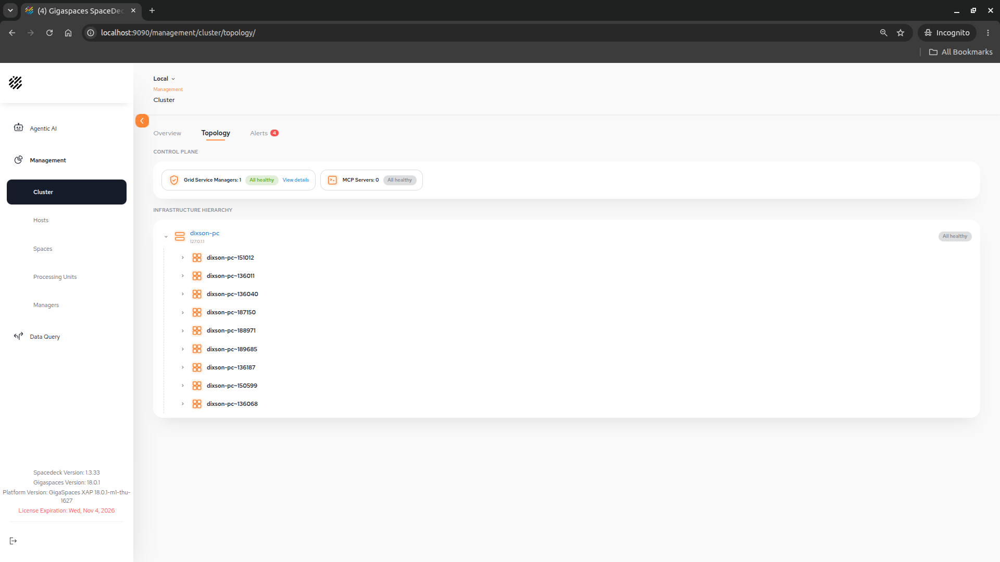

### 3 UI DEMO termination

From ui-demo folder run:  
 * `./undeploy_all.sh`

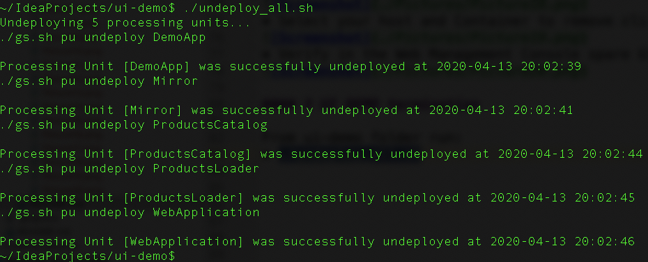
 * Shutdown the GS run time environment and roll back setenv-overrides.sh (delete or comment GS_GSC_OPTIONS line).
