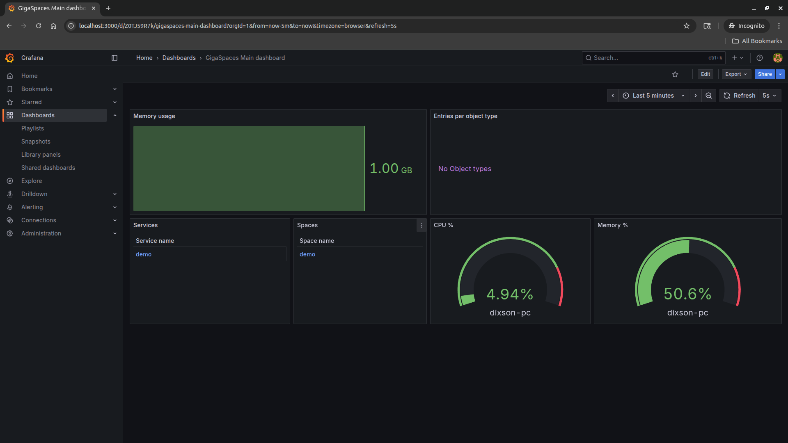
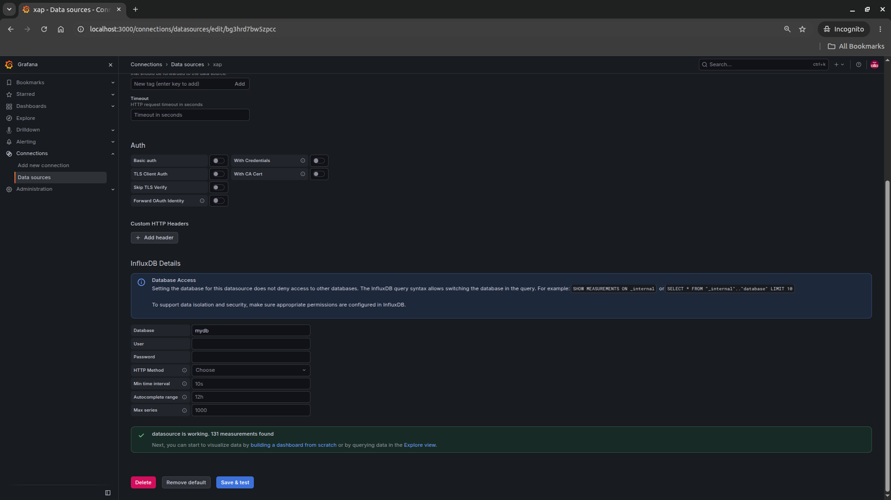
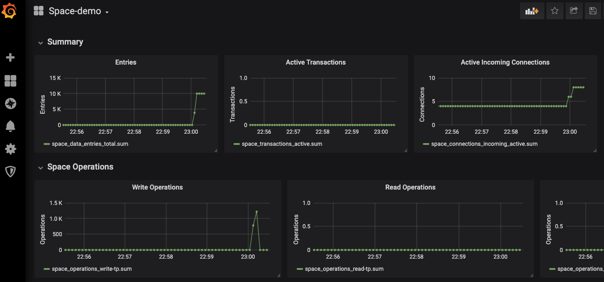

# gs-admin-training - lab06-metrics

# GigaSpaces Metrics

## Lab Goals

 * Explore the GigaSpaces metrics framework.
 * Get familiar with Grafana and InfluxDB.

## Lab Description
In this lab we will focus on GigaSpaces Metrics functionality.  
To better understand its capabilities you will set up InfluxDB and Grafana.

### 1 Download and install InfluxDB and Grafana

1. Choose for your convenience, 1 of the following 2 options:

    * InfluxDB regular installation  
      https://www.influxdata.com/get-influxdb/

    * InfluxDB installation using docker compose  
      https://docs.docker.com/compose/install/  
      Docker Compose (`docker compose`) is used for the convenience of managing the network communication between multiple containers. 
      ```
      cd $GS_ADMIN_TRAINING/lab06-metrics
      docker compose up
      ```

2. Create mydb database

   Follow the instructions to create **mydb** database:  
   https://docs.influxdata.com/influxdb/v1/introduction/get-started/

   **Tip:** For docker please use the following command first:<br>
   ```
   docker exec -it <container ID> /bin/bash # get a terminal session into the InfluxDB container
   # start influx interactive session
   influx
   create database mydb
   ```

### 2 Download and install Grafana

1. Choose for your convenience, 1 of the following 2 options:

   * Grafana regular installation:  
     https://grafana.com/get
   * Grafana installation using docker compose:  
     Grafana was already started when `docker compose up` was run for InfluxDB.

2. Verify Grafana is up and running

   * Click the following link:  
     http://localhost:3000/

     See that you can login admin/admin (skip the change password page).

### 3 Activate GS metrics
Please follow instructions at:  
https://docs.gigaspaces.com/latest/admin/metrics-configuration.html#Configuration

*Edit the* `$GS_HOME/config/metrics/metrics.properties` *file, look for the InfluxDB and Grafana sections and uncomment them*.  
(Beginning with 17.3.0, `metrics.xml` has been replaced by `metrics.properties`.) For this lab the following settings are sufficient:
```
metrics.registries=influxdb
metrics.influxdb.uri=http://localhost:8086
metrics.influxdb.db=mydb
metrics.influxdb.step=10
grafana.url=http://localhost:3000
grafana.user=admin
grafana.password=admin
grafana.datasource.name=xap
grafana.datasource.type=influxdb
grafana.datasource.isDefault=true
grafana.datasource.access=proxy
```
The metrics configuration is read when the service grid starts, so make these changes before running the next step.

### 4 Start the service grid and deploy a space
1. Go to `$GS_HOME/bin`
2. Make sure `GS_MANAGER_SERVERS` is set in `setenv-overrides.sh`:
   ```
   export GS_MANAGER_SERVERS="localhost"
   ```
3. Start the service grid: `./gs.sh host run-agent --manager --webui --restv3 --gsc=4`
4. In a new console window in `$GS_HOME/bin`, deploy a space named `demo` with 2 partitions and 1 backup each:
   ```
   ./gs.sh space deploy --partitions=2 --ha demo
   ```
### 5 Explore Grafana dashboards

Please explore Grafana GS dashboard and see that metrics are arriving:



Note: GigaSpaces creates the `xap` datasource in Grafana and tries to load the dashboards automatically. If no GigaSpaces dashboards appear in Grafana (check the restv3 log, `$GS_HOME/logs/*-gigaspaces-restv3_*.log`, for `Failed to add dashboard`), import them manually from `$GS_HOME/config/grafana/dashboards` (Grafana: Dashboards | New | Import | Upload dashboard JSON file). Use the files at the top level of that directory (titles ending in `_new`), which match the metric names used since 17.3.0 (verified on 18.0.1); the files under `refs/` are the older dashboards and several of their panels will be empty.

### 6 Troubleshooting:

* InfluxDB connectivity test can be done:


* Check the log files at `$GS_HOME/logs`.

* An interactive Influxdb session can be started and select statements can be run:
For example,
```
select * from "space_data_total-read-count"
```

* Grafana uses http to query InfluxDB.
For example, you could run the following from the browser:
```
http://localhost:8086/query?db=mydb&q=SELECT%20*%20from%20%22space_data_total-read-count%22
```

### 7 Space dashboard:

Write objects to the `demo` space with the benchmark tool from lab03-application_components (`mvn package` in `$GS_ADMIN_TRAINING/lab03-application_components`, then run `scripts/writeObjects.sh`; GigaSpaces 18.0 requires Java 25). Then explore the **GigaSpaces Spaces dashboard_new** dashboard (open it from the Grafana Dashboards list and select Space `demo`) and see the write operations and entries arrive.

*Legacy: the screenshot below shows the older Space-demo dashboard, whose panels used metric names that have since been removed.*


### 8 Additional Resources
 * https://hub.docker.com/_/influxdb  
 * https://hub.docker.com/r/grafana/grafana
