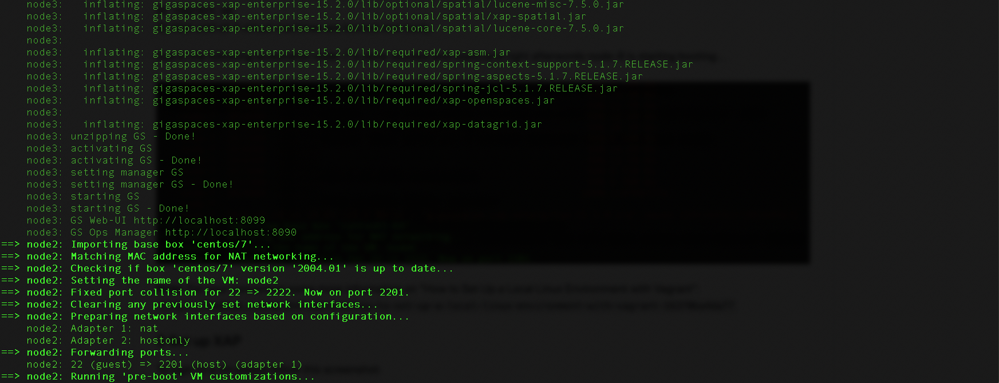

# gs-admin-training - lab07-gigaspaces_manager (older version: Vagrant)

> **Older version of this lab.** This is the VirtualBox + Vagrant version of lab07, kept for reference. It was last updated for GigaSpaces 17.3.0 and has not been updated for 18.0 (its scripts still install Java 17, download GigaSpaces 17.3.0 and use the REST Manager on port 8090).
> For the current version of the lab, which uses Docker, see the [lab07 README](../README.md).

## Lab Description
In this version of the lab you set up a 4 machine cluster based on Vagrant.

### 1 Setup Vagrant framework on your machine

#### Install VirtualBox

https://www.virtualbox.org/wiki/Downloads

#### Install Vagrant

https://www.vagrantup.com/downloads.html

### 2 "vagrant up" and provisioning your virtual machine

1. `cd ~/gs-admin-training/lab07-gigaspaces_manager/Vagrant`
2. `vagrant up`
3. Wait until all 4 virtual machines are booted and ready.

See in the following screenshot node3 is done (booted and ready) and immediately after node2 has started to boot...  


**Note:** For more information on "How to Set Up a Local Linux Environment with Vagrant":  
`https://medium.com/@JohnFoderaro/how-to-set-up-a-local-linux-environment-with-vagrant-163f0ba4da77`


### 3 Explore the cluster

Please connect to the REST Manager using the cli. You will need to use your local `$GS_HOME` installation. See commands below.   
It should be available on all manager machines: node1, node2 and node3.  
On node4 you shouldn't be able to connect to the REST Manager as it is a machine without GigaSpaces Manager.  
*Note: Use the --server option to connect to a specific GigaSpaces Manager node.*  
```
dixson@dixson-pc:~/gigaspaces-smart-cache-enterprise-17.3.0/bin$ ./gs.sh --server=10.211.55.101:8090 host list

HOST NAME    HOST ADDRESS     CONTAINERS COUNT    
node4        10.211.55.104    0                   
node2        10.211.55.102    0                   
node3        10.211.55.103    0                   
node1        10.211.55.101    0                   


SUMMARY        
Hosts:         4    
Containers:    0    

dixson@dixson-pc:~/gigaspaces-smart-cache-enterprise-17.3.0/bin$ ./gs.sh --server=10.211.55.101:8090 info

INFO
Lookups Groups   xap-17.3.0
Managers         node1,node2,node3
Revision         17.3.0
Started On       2025-10-07 18:30:25.514
Version          17.3.0

```

If you see the above, lab has been completed successfully by you :-)


**Tip:**  
To login to the machines goto the Vagrant directory and run:<br>
    `vagrant ssh node1` (e.g. login to node1)

### 4 Note:

 * If you see the following error:

The IP address configured for the host-only network is not within the
allowed ranges. Please update the address used to be within the allowed
ranges and run the command again.

Continue with the recommendations mentioned.

Edit `/etc/vbox/networks.conf`, add the following:
```
      * 10.0.0.0/8 192.168.0.0/16
      * 2001::/64
```
 * To determine the ip address to access the ui:
```
vagrant ssh node1
ip address show
```
For example:
| Node | IP Address |
|------|------------|
| Node1 | http://10.211.55.101:8090/ |
| Node2 | http://10.211.55.102:8090/ |
| Node3 | http://10.211.55.103:8090/ |
| Node4 | 10.211.55.104 (No web-ui or GigaSpaces Manager running)|     
