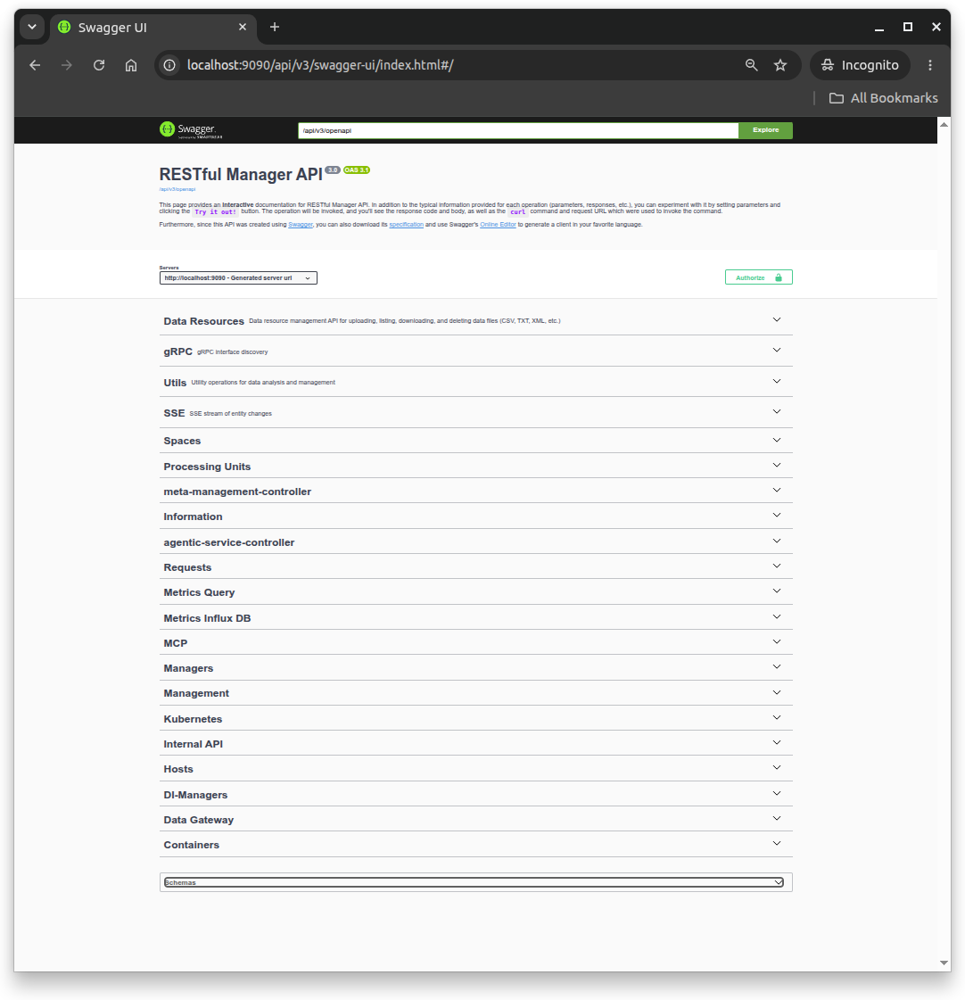
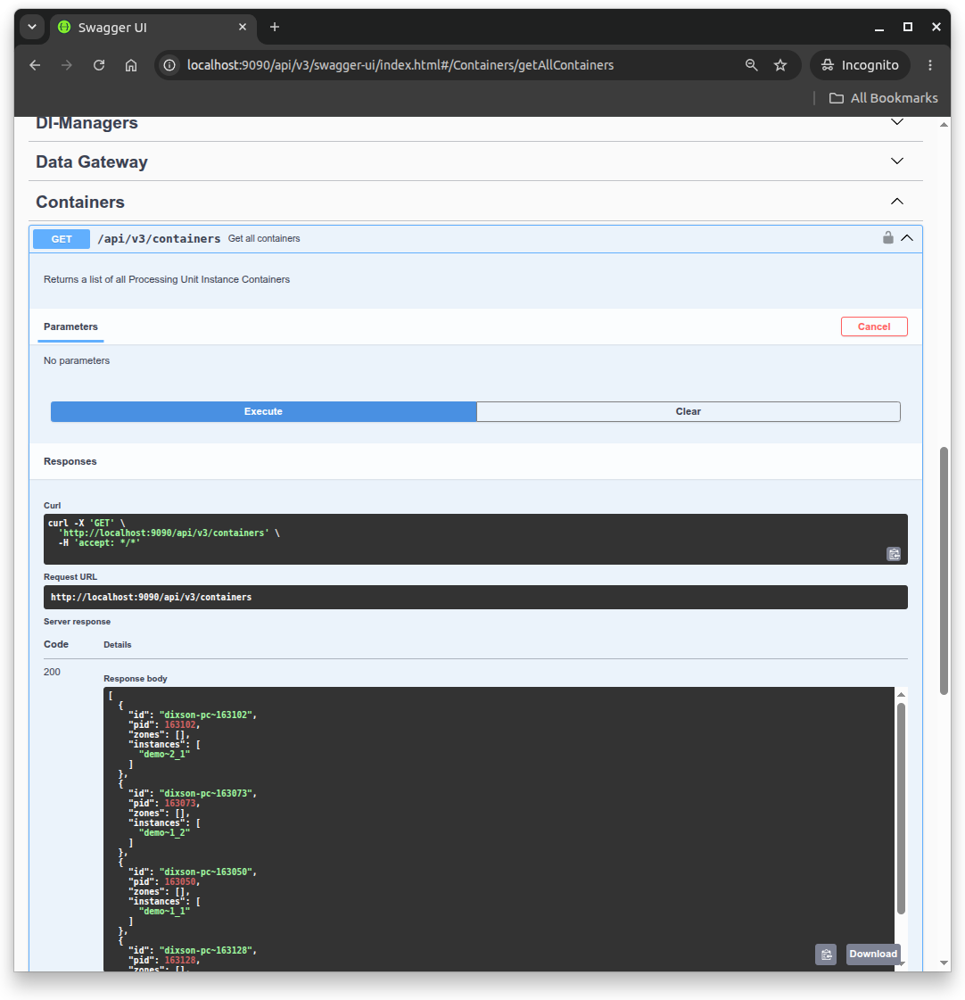
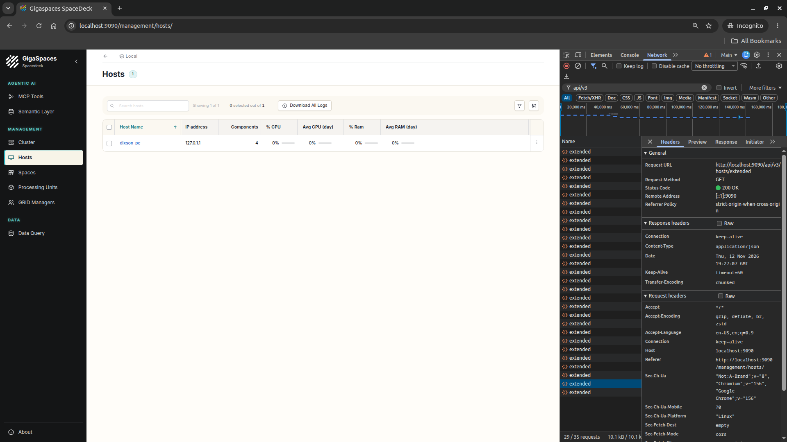
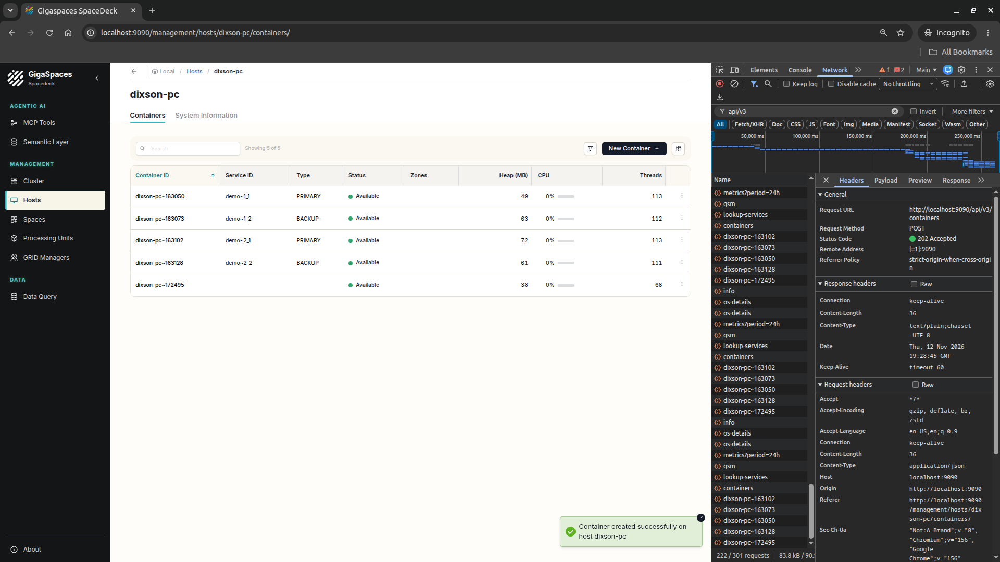
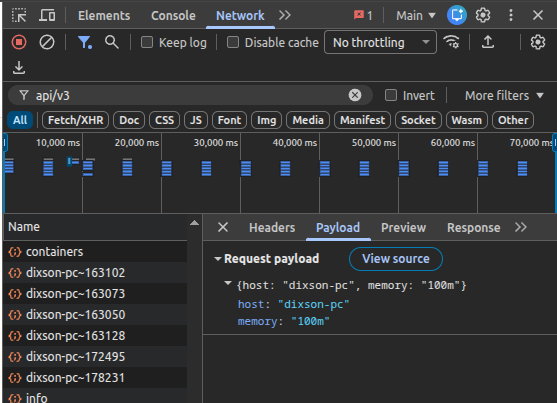
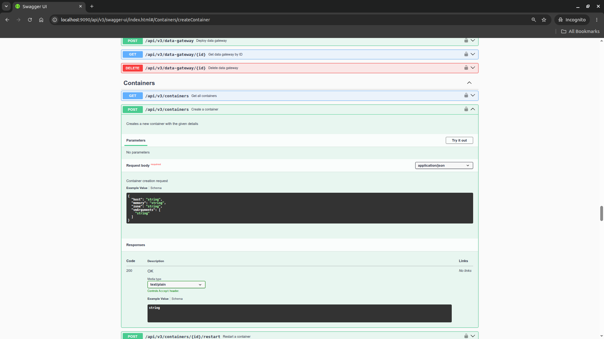

# gs-admin-training - lab10-rest_manager_api

# GigaSpaces REST Manager API

## Lab Goals

1. Understand when the REST Manager API is the right tool.
2. Create GSCs, deploy a space, load data and relocate an instance with `curl`.
3. Read the grid alerts over REST.
4. Automate a full environment build with a short script.

## Why the REST Manager API
SpaceDeck is great for looking at a grid, and `gs.sh` is great at a terminal on a grid machine. The REST Manager API (REST v3) is for everything else:

* **Any language, any tool.** It is plain HTTP and JSON. A CI/CD pipeline, an Ansible playbook, a Kubernetes job, a monitoring system or a Python script can manage the grid with no GigaSpaces client installed.
* **Remote.** It runs on the manager, so the caller does not have to be on a grid machine. With security enabled, every call is authenticated.
* **Complete.** Hosts, containers, processing units, spaces, data, statistics and alerts: SpaceDeck itself is built on this API (you will see this in step 3).
* **Built for automation.** Every change returns a request id that you can track until it succeeds or fails, so a script always knows when a step is done.

In this lab you type each call yourself with `curl` and `jq`, and in the last step you put them together in a script.

### Prerequisites
* `curl` and `jq` are installed.
* The Swagger UI at `http://localhost:9090/api/v3/swagger-ui/index.html` (available once the grid runs) documents every call in the API. You can try each call there too.

### 1 Start the GigaSpaces manager without GSCs

1. Go to `$GS_HOME/bin`
2. Make sure `GS_MANAGER_SERVERS` is set in `setenv-overrides.sh`:
   ```
   export GS_MANAGER_SERVERS="localhost"
   ```
3. Start the manager, the web UI and REST v3, with no GSCs:
   ```
   ./gs.sh host run-agent --manager --webui --restv3
   ```
4. In a new terminal, go to the lab folder and set the REST URL:
   ```
   cd ~/gs-admin-training/lab10-rest_manager_api
   export REST_URL=http://localhost:9090/api/v3
   ```

### 2 Explore the grid
Run these read-only calls and look at the responses:
```
curl -s $REST_URL/info | jq
curl -s $REST_URL/hosts | jq
curl -s $REST_URL/containers | jq
curl -s $REST_URL/pus | jq
curl -s $REST_URL/spaces | jq
```
There are no containers, processing units or spaces yet. Keep the host name from `/hosts`, you need it to create GSCs:
```
export GS_HOST=$(curl -s $REST_URL/hosts | jq -r '.[0].name')
echo $GS_HOST
```
Open the Swagger UI and find these calls under **Information**, **Hosts**, **Containers**, **Processing Units** and **Spaces**. Look at what else each section offers.



Expand **Containers** | `GET /api/v3/containers`, click **Try it out** and then **Execute**. Swagger shows the `curl` command it ran, the request URL and the response, the same JSON you get from `curl` in the terminal:



### 3 See SpaceDeck use the same API
1. Open SpaceDeck at `http://localhost:9090/` in Chrome or Firefox.
2. Open the browser's developer tools (F12), select the **Network** tab and type `api/v3` in its filter box.
3. Click through SpaceDeck ('Management' | 'Hosts', 'Management' | 'Processing Units'). Each page loads its data with REST v3 calls such as `GET /api/v3/hosts/extended` and `GET /api/v3/pus`, and repeats them every few seconds to stay current. Click a call to see its request URL:

   
4. Create one container in SpaceDeck: 'Management' | 'Hosts', click your host, open the 'Containers' tab and click 'New Container'. The memory field is empty; enter `100m`, the size of every GSC in this lab. In the Network tab, find the `POST /api/v3/containers` call. It returns `202 Accepted`, and its response is a request id, just like the `curl` calls in step 4.

   

   Open its **Payload** tab. SpaceDeck sent a host and a memory size, the same JSON body you will send with `curl` in step 4:

   
5. Back in the terminal, the new container is there:
   ```
   curl -s $REST_URL/containers | jq -r '.[].id'
   ```

Everything SpaceDeck does, you can do with the same calls.

### 4 Create GSCs and deploy a space
Write calls are asynchronous. They return a **request id** right away, and you check the result with `GET /requests/{id}`.

1. Create a 100 MB GSC and look at its request:
   ```
   request=$(curl -s -X POST $REST_URL/containers -H 'Content-Type: application/json' \
        -d "{\"host\": \"$GS_HOST\", \"memory\": \"100m\"}")
   echo $request
   curl -s $REST_URL/requests/$request | jq
   ```
   Swagger (**Containers** | `POST /api/v3/containers`) shows every field the request body accepts. Besides `host` and `memory`, you can set a `zone` and extra JVM options (`vmArguments`):

   

   Repeat the last command until `status` changes from `running` to `successful` (a few seconds). The request then has a `statusUrl` that ends with the id of the new container:
   ```
   {
     "id": "a4e1eb2b-6d2f-431b-b0c5-9195264ffad0",
     "description": "Create container on host myhost with memory=100m",
     "statusUrl": "http://localhost:9090/api/v3/containers/myhost~142325",
     ...
     "status": "successful"
   }
   ```
2. Create two more, so that there are 4 GSCs with the one from step 3 (if you skipped step 3, use `for i in 1 2 3`):
   ```
   for i in 1 2; do
       curl -s -X POST $REST_URL/containers -H 'Content-Type: application/json' \
            -d "{\"host\": \"$GS_HOST\", \"memory\": \"100m\"}"; echo
   done
   curl -s $REST_URL/containers | jq -r '.[].id'
   ```
3. Deploy the space `demo` with 2 partitions and a backup for each partition:
   ```
   request=$(curl -s -X POST "$REST_URL/spaces?name=demo&partitions=2&backups=true")
   curl -s $REST_URL/requests/$request | jq -r .status
   ```
   Repeat the second command until it prints `successful`. On a fresh grid this can take 15-30 seconds.
4. Each GSC now hosts one instance:
   ```
   curl -s $REST_URL/containers | jq -r '.[] | "\(.id)\t\(.instances)"'
   ```
   ```
   myhost~142397	["demo~2_1"]
   myhost~142351	["demo~1_2"]
   myhost~142325	["demo~1_1"]
   myhost~142373	["demo~2_2"]
   ```
   Container ids (`<host>~<pid>`) will differ.

### 5 Load data and read the instance utilization
1. Register a `Data` type in the space:
   ```
   curl -s -X POST $REST_URL/spaces/demo/types/Data -H 'Content-Type: application/json' \
        -d '{"id": ["id"], "routingProperty": "id",
             "properties": {"id": "java.lang.Integer", "txt1": "java.lang.String",
                            "txt2": "java.lang.String", "txt3": "java.lang.String"}}'
   ```
2. Generate 60000 objects of that type (at most 100000 per call), and check the request:
   ```
   request=$(curl -s -X POST $REST_URL/spaces/demo/types/Data/objectsNum/60000/generateDemoData)
   curl -s $REST_URL/requests/$request | jq '.status, .result'
   ```
3. Count the entries in the space. Right after loading, the count can show 0 for a few seconds:
   ```
   curl -s $REST_URL/spaces/demo/statistics/types | jq
   ```
4. Read the heap usage and object count of each instance:
   ```
   curl -s $REST_URL/pus/demo/instancesUtilization | jq -r 'sort_by(.id)[] |
       "\(.id)\t\(.mode)\t\(.containerId)\theap \(.memoryHeapUsedPerc * 100 | floor)% of \(.memoryHeapMaxInBytes / 1048576 | floor) MB\t\(.objectCount) objects"'
   ```
   ```
   demo~1_1	PRIMARY	myhost~142325	heap 79% of 100 MB	30000 objects
   demo~1_2	BACKUP	myhost~142351	heap 62% of 100 MB	30000 objects
   demo~2_1	PRIMARY	myhost~142397	heap 57% of 100 MB	30000 objects
   demo~2_2	BACKUP	myhost~142373	heap 57% of 100 MB	30000 objects
   ```
   Each partition holds half of the 60000 objects, and each backup holds the same objects as its primary.
5. Run it a few times over a couple of minutes. The heap percentage goes up and then drops sharply: the JVM fills the heap with short-lived objects and the garbage collector frees them every few minutes. A single heap reading is a poor measure of how full a GSC really is; the object count, or the heap level right after a collection, says more.

### 6 Relocate an instance to a larger GSC
The 100 MB GSCs are small. Move `demo~1_1` to a new 256 MB GSC.

1. Find the instance's GSC:
   ```
   curl -s $REST_URL/pus/demo/instancesUtilization | jq '.[] | select(.id == "demo~1_1") | {containerId, hostId, mode}'
   ```
2. Create the new GSC:
   ```
   request=$(curl -s -X POST $REST_URL/containers -H 'Content-Type: application/json' \
        -d "{\"host\": \"$GS_HOST\", \"memory\": \"256m\"}")
   curl -s $REST_URL/requests/$request | jq -r '.status, .statusUrl'
   ```
   Repeat the second command until it prints `successful`. The new container id is the last part of the `statusUrl`.
3. Relocate the instance to the new GSC (replace `<new container id>`), and check the request:
   ```
   request=$(curl -s -X POST "$REST_URL/pus/demo/instances/demo~1_1/relocate?containerId=<new container id>")
   curl -s $REST_URL/requests/$request | jq -r .status
   ```
   Always pass `containerId`. Without it the grid picks the target GSC itself, and it can place a primary in the same GSC as its own backup.
4. The old GSC is now empty. Check it, then delete it (replace `<old container id>`):
   ```
   curl -s $REST_URL/containers/<old container id> | jq .instances
   curl -s -X DELETE $REST_URL/containers/<old container id>
   ```
5. Run the utilization call from step 5 again:
   ```
   demo~1_1	BACKUP	myhost~143523	heap 35% of 256 MB	30000 objects
   demo~1_2	PRIMARY	myhost~142351	heap 46% of 100 MB	30000 objects
   demo~2_1	PRIMARY	myhost~142397	heap 57% of 100 MB	30000 objects
   demo~2_2	BACKUP	myhost~142373	heap 58% of 100 MB	30000 objects
   ```
   `demo~1_1` is now in a GSC with a heap of about 256 MB, and it keeps its objects. If it was a primary, it is now the backup: when a primary moves, its backup takes over as primary.

### 7 Alerts
Alerts are configured in lab05 (SpaceDeck). Here you read them over REST.

1. In a new terminal, show the latest 8 alerts every 5 seconds:
   ```
   export REST_URL=http://localhost:9090/api/v3
   while true; do
       clear
       curl -s $REST_URL/alerts/list | jq -r 'sort_by(.timestamp)[-8:][] |
           "\(.timestamp / 1000 | localtime | strftime("%H:%M:%S")) \(.status) \(.severity) \(.name)\n    \(.description)"'
       sleep 5
   done
   ```
   You may see alerts that were raised earlier, for example by the relocation.
2. In the first terminal, delete one of the 100 MB GSCs (pick one from `curl -s $REST_URL/containers | jq -r '.[].id'`):
   ```
   curl -s -X DELETE $REST_URL/containers/<container id>
   ```
   The lost instance raises alerts, and the processing unit stays `compromised` (`curl -s $REST_URL/pus/demo | jq .status`) because there is no free GSC to provision the instance on:
   ```
   13:26:41 RAISED SEVERE Replication Channel Disconnected
       A replication channel has been lost between primary Space demo.1 [1] and Space demo.1 [2]
   13:26:43 RAISED WARNING Member Alive Indicator
       Suspecting failure of demo.1 [2]
   13:26:45 RAISED SEVERE Provision Failure
       Processing unit demo has less than 4 instances running
   13:26:45 RAISED SEVERE Member Alive Indicator
       Detected failure of demo.1 [2]
   ```
3. Create a new GSC:
   ```
   curl -s -X POST $REST_URL/containers -H 'Content-Type: application/json' \
        -d "{\"host\": \"$GS_HOST\", \"memory\": \"100m\"}"
   ```
   The missing instance is provisioned on it, copies its objects from its primary, and the alerts change to `RESOLVED`:
   ```
   13:27:33 RESOLVED SEVERE Provision Failure
       Processing unit demo has instantiated successfully all 4 instances
   13:27:33 RESOLVED SEVERE Member Alive Indicator
       Re-provisioned demo.1 [2] instance
   13:27:33 RESOLVED SEVERE Replication Channel Disconnected
       A replication channel has been restored between primary Space demo.1 [1] and Space demo.1 [2]
   ```
4. Stop the loop with Ctrl-C.

A monitoring system can poll `GET /alerts/list` the same way and forward new alerts to email, Slack or a pager.

### 8 Automate it
You have now built an environment one call at a time. [`scripts/build-env.sh`](scripts/build-env.sh) does steps 4 and 5 in one go: it creates the GSCs, deploys the space, loads the data, and waits on every request so that each step starts only when the previous one has succeeded. Read it first; it uses only the calls you already know.

1. Tear down the environment, with REST too: undeploy the space, then delete every GSC:
   ```
   request=$(curl -s -X DELETE $REST_URL/pus/demo)
   curl -s $REST_URL/requests/$request | jq -r .status
   for id in $(curl -s $REST_URL/containers | jq -r '.[].id'); do
       curl -s -X DELETE $REST_URL/containers/$id; echo
   done
   ```
2. Rebuild it:
   ```
   ./scripts/build-env.sh
   ```
   ```
   13:37:52 Grid at http://localhost:9090/api/v3: GigaSpaces 18.0.1, managers localhost
   13:37:52 Creating 4 GSCs of 100m on myhost
   13:37:56   GSC myhost~151895
   13:37:56   GSC myhost~151917
   13:37:56   GSC myhost~151943
   13:37:56   GSC myhost~151968
   13:37:56 Deploying space demo (2 partitions with backups)
   13:38:11 Loading 60000 Data objects
   13:38:15 Done. Instances of demo:
     demo~1_1	PRIMARY	myhost~151895	30000 objects
     demo~1_2	BACKUP	myhost~151917	30000 objects
     demo~2_1	PRIMARY	myhost~151943	30000 objects
     demo~2_2	BACKUP	myhost~151968	30000 objects
   ```
   If the space is already deployed, the script stops with `ERROR: space demo is already deployed`.
3. Try it with other settings, for example 3 partitions and fewer objects (tear down first):
   ```
   PARTITIONS=3 OBJECTS=10000 ./scripts/build-env.sh
   ```

Think about where you would run a script like this: a CI pipeline that builds a test environment before the integration tests, a nightly job that rebuilds a demo environment, or a runbook step that adds capacity. None of them needs anything on the machine but `curl` and `jq`.

### 9 Clean up
```
curl -s -X DELETE $REST_URL/pus/demo
cd $GS_HOME/bin
./gs.sh host kill-agent
```
