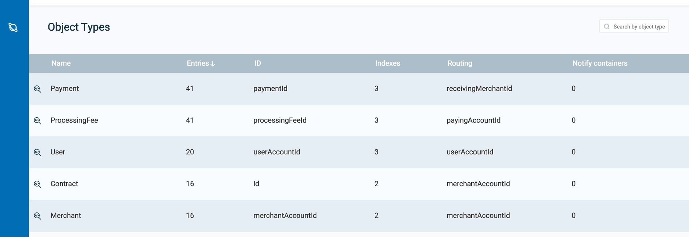

# gs-admin-training - lab12-memoryxtend

# The Bill Buddy Application with MemoryXtend

## Lab Goals

1. Experience an application deployment process.
2. Get familiar with the BillBuddy application.
3. Use GigaSpaces MemoryXtend. 

## Lab Description
You will understand MemoryXtend and its benefits by deploying a GigaSpaces application.

### Initial deployment

---
#### Start the service grid

 1. Navigate to `$GS_HOME/bin`
        
 2. Start **GigaSpaces agent** with a local Manager server and 5 GSCs:
    ```
    ./gs.sh host run-agent --auto --gsc=5
    ```
    
#### Deploy BillBuddy_Space
    
1. Open `$GS_ADMIN_TRAINING_HOME/lab12-memoryxtend` project with Intellij (open the pom.xml).
2. Run mvn package
    ```
        ~/gs-admin-training/lab12-memoryxtend$ mvn package
        
        
        [INFO] Reactor Summary:
        [INFO] 
        [INFO] lab12-memoryxtend ............................................... SUCCESS [  0.204 s]
        [INFO] BillBuddyModel ..................................... SUCCESS [  1.087 s]
        [INFO] BillBuddy_Space .................................... SUCCESS [  0.207 s]
        [INFO] BillBuddyAccountFeeder ............................. SUCCESS [  0.189 s]
        [INFO] BillBuddyCurrentProfitDistributedExecutor .......... SUCCESS [  0.225 s]
        [INFO] BillBuddyPaymentFeeder ............................. SUCCESS [  0.190 s]
        [INFO] ------------------------------------------------------------------------
        [INFO] BUILD SUCCESS
    ```
3. IntelliJ path Variables (under preferences)

    ###### Add GS_LOOKUP_GROUPS & GS_LOOKUP_LOCATORS

    For example set `GS_LOOKUP_LOCATORS=localhost` and `GS_LOOKUP_GROUPS=xap-17.3.0`

4. Copy the runConfigurations directory to the Intellij **.idea** directory to enable the Java Application configurations. Restart Intellij.

5. Open a new Terminal and navigate to `$GS_HOME/bin`
    ```
    cd $GS_HOME/bin
    ```
6. Use the gs CLI to deploy the BillBuddy_Space:
    ``` 
    ./gs.sh pu deploy BillBuddySpace ~/gs-admin-training/lab12-memoryxtend/BillBuddy_Space/target/BillBuddy_Space.jar 
    ```
#### Populate Users and Merchants
###### Run BillBuddyAccountFeeder from Intellij

1. From Intellij select the BillBuddyAccountFeeder configuration and run it.

    ###### This application writes Users, Merchants and Contracts to the Space
 
2. Validate Users and Merchants were written to the space. From `$GS_HOME/bin` run:
    ```
    $ ./gs.sh space info --type-stats BillBuddySpace
    ...
    TYPES    
     DATA TYPE NAME                          OBJECTS COUNT    TEMPLATES COUNT    
     com.gs.billbuddy.model.Merchant         16               0                  
     com.gs.billbuddy.model.User             20               0                  
     com.gs.billbuddy.model.Contract         16               0                  
     java.lang.Object                        0                0                  
    ```
    Please refer to 'lab03-application_components' for other ways to check data types (Ops Manager, REST).


3. Query the list of Users with the gs CLI:
    ```
    $ ./gs.sh space query --max-results=5000 BillBuddySpace com.gs.billbuddy.model.User

    address                                    balance                creditLimit    name                status    userAccountId    
    com.gs.billbuddy.model.Address@cd58fea     -557.1299999999999     -10000.0       Bill Klien          ACTIVE    11               
    com.gs.billbuddy.model.Address@39a8739b    -597.3000000000001     -10000.0       Magic Jordan        ACTIVE    13               
    ...

    SUMMARY     
    Results:    20    
    ```
    * Without `--max-results` the CLI returns at most 10 rows.
    * Use `--columns` to select columns and `--filter` to add a WHERE predicate:
    ```
    $ ./gs.sh space query --columns=userAccountId,name,balance --filter="userAccountId<5" BillBuddySpace com.gs.billbuddy.model.User

    userAccountId    name                balance                
    1                James Johnson       -431.96000000000004    
    3                Andrei Saizovsky    -393.54                
    2                Peter Gardener      -534.07                
    4                Petr Kirul          -436.96000000000004    

    SUMMARY     
    Results:    4    
    ```

    ###### Note: Fully qualified class name is required.
    ###### Note: Do not put spaces inside the `--filter` value (`"userAccountId<5"`, not `"userAccountId < 5"`). gs.sh passes its arguments on unquoted, so a space splits the filter and the command fails with `Unmatched arguments`.
    ###### Note: `rownum` is not supported by the CLI filter (`Column 'rownum' not found in any table`); use `--max-results` instead.

    Alternatively, the equivalent SQL `SELECT * FROM com.gs.billbuddy.model.User WHERE rownum<5000` can be run from a SQL client. Please refer to 'lab03-application_components' for instructions.


#### Simulate transactions
 * The BillBuddyPaymentFeeder application creates payments by randomly choosing a user, a merchant and an amount and performs the initial process of a payment.
 * This includes deposit and withdrawal updates of each party’s balance appropriately.
 * After the payment is initially processed it is written to the space for further processing.
 * A new Payment is created every second.
 
1. Run the BillBuddyPaymentFeeder using Intellij:  
   Use the same instructions as used for the BillBuddyAccountFeeder.

2. Validate Payments were written to the space.    
   Check the Payment Data Type Name as you did in section above for Merchants and Users (`./gs.sh space info --type-stats BillBuddySpace`).
   Each Payment is also processed by the space, which writes a matching `com.gs.billbuddy.model.ProcessingFee`.
   To look at some payments:
    ```
    $ ./gs.sh space query --max-results=5 --columns=paymentAmount,description,status --filter="paymentAmount>90" BillBuddySpace com.gs.billbuddy.model.Payment

    paymentAmount    description    status       
    97.83            GARDEN         PROCESSED    
    99.47            SPORT          PROCESSED    
    ...
    ```
 
3. Go to the statistics operations and see that a payment is actually added every second.  
   Run the following a few times and watch `Write Count` and `Write per sec`:
    ```
    ./gs.sh space info --operation-stats BillBuddySpace
    ```
   Please refer to 'lab03-application_components' for other ways to check operations statistics.

4. Check Data Types. See how many records are in the space (`./gs.sh space info --type-stats BillBuddySpace`).  

### Undeployment

---
#### Undeploy the space:  
   `./gs.sh pu undeploy BillBuddySpace`

### Deploy and restore data from disk

---
#### Deploy the space and verify that all records were restored from disk.
```
./gs.sh pu deploy BillBuddySpace ~/gs-admin-training/lab12-memoryxtend/BillBuddy_Space/target/BillBuddy_Space.jar
```
Once again, check the data types to see the records were restored from the disk back to the space.  
The counts should match the counts you saw before undeploying:
```
./gs.sh space info --type-stats BillBuddySpace
```



### Additional resources

---
See:  
 * https://docs.gigaspaces.com/latest/admin/x-memoryxtend-overview.html
 * https://docs.gigaspaces.com/latest/admin/memoryxtend-rocksdb-ssd.html
